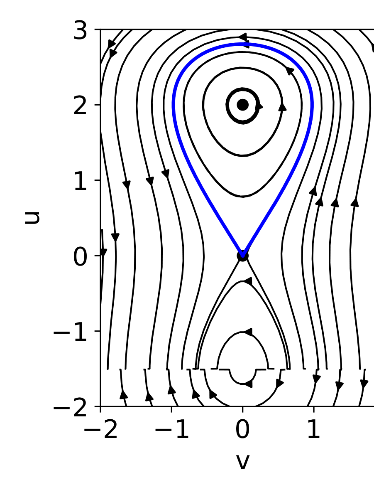

<!-- Generated by build_publications.py; do not edit by hand. -->

```{=html}
<div class="paper-info">

<p class="paper-venue"><span class="pub-journal">J. Sci. Comput.</span>, 103(3):90 (2025)</p>
<p class="pub-links"><a href="https://doi.org/10.1007/s10915-025-02898-x">Published version</a> | <a href="https://arxiv.org/abs/2412.17117">arXiv version</a></p>
<div style="clear:both"></div>
</div>
```

## Abstract

We study the recently-proposed hyperbolic approximation of the Korteweg-de Vries equation (KdV). We show that this approximation, which we call KdVH, possesses a rich variety of solutions, including solitary wave solutions that approximate KdV solitons, as well as other solitary and periodic solutions that are related to higher-order water wave models, and may include singularities. We analyze a class of implicit-explicit Runge-Kutta time discretizations for KdVH that are asymptotic preserving, energy conserving, and can be applied to other hyperbolized systems. We also develop structure-preserving spatial discretizations based on summation-by-parts operators in space including finite difference, discontinuous Galerkin, and Fourier methods. We use the entropy relaxation approach to make the fully discrete schemes energy-preserving. Numerical experiments demonstrate the effectiveness of these discretizations.

<p class="abstract-source">Abstract of the arXiv version, <a href="https://arxiv.org/abs/2412.17117">arXiv:2412.17117</a>.</p>

## Code and data

Reproducibility repository: <https://github.com/abhibsws/2024_kdvh_RR>
