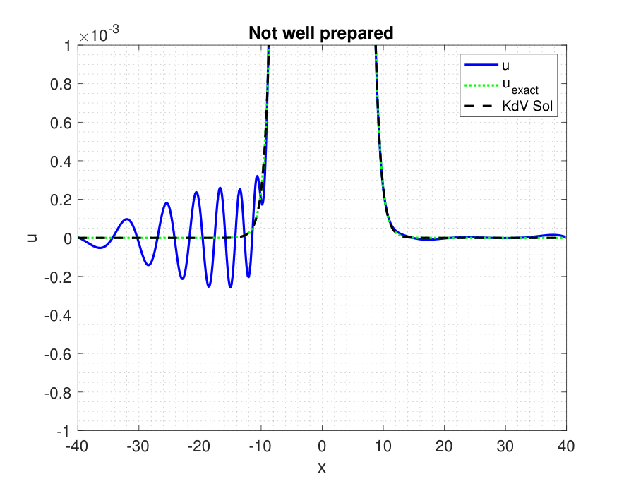

<!-- Generated by build_publications.py; do not edit by hand. -->

```{=html}
<div class="paper-info">

<p class="paper-venue"><span class="pub-journal">arXiv preprint arXiv:2609.22864</span> (2026)</p>
<p class="pub-links"><a href="https://arxiv.org/abs/2609.22864">arXiv version</a></p>
<div style="clear:both"></div>
</div>
```

## Abstract

We study the application of exponential time integration methods, coupled with Fourier pseudospectral space discretization, to the hyperbolic Korteweg-de Vries (KdVH) system. We investigate the asymptotic preserving (AP) properties of such discretizations, showing that, in general, Lawson methods are not asymptotic preserving, because the auxiliary (derivative-approximating) variables do not satisfy the limit equilibrium manifold, whereas exponential time differencing (ETD) methods are AP for all components, including both the solution variable and the auxiliary variables. We also present an efficient numerical implementation based on an exact formula for the matrix exponential of this system, and compare it with previously-proposed ImEx Runge-Kutta time integration, showing that exponential methods can be competitive in this context.

<p class="abstract-source">Abstract of the arXiv version, <a href="https://arxiv.org/abs/2609.22864">arXiv:2609.22864</a>.</p>

## Code and data

Reproducibility repository: <https://github.com/abhibsws/AP_Exp_Int_KdVH_RR>
