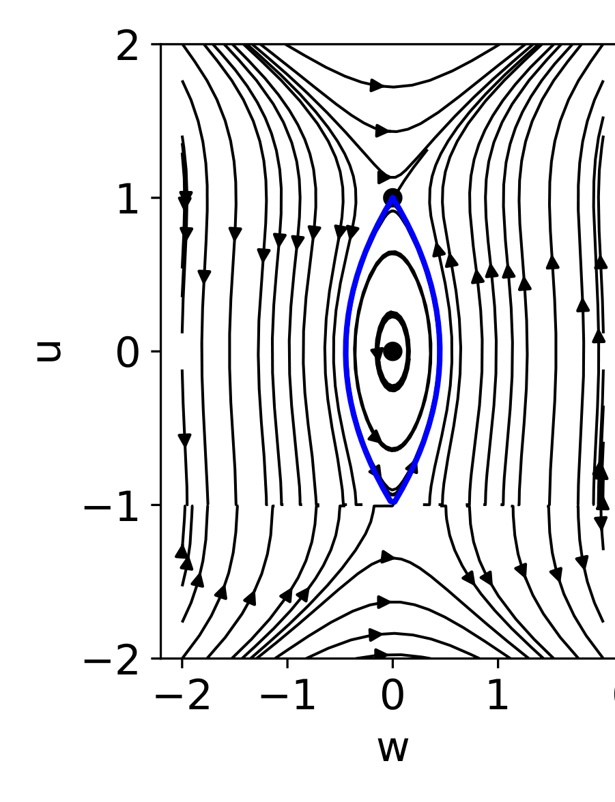

<!-- Generated by build_publications.py; do not edit by hand. -->

```{=html}
<div class="paper-info">

<p class="paper-venue"><span class="pub-journal">Communications on Applied Mathematics and Computation</span> (2025)</p>
<p class="pub-links"><a href="https://doi.org/10.48550/arXiv.2511.10044">Published version</a> | <a href="https://arxiv.org/abs/2511.10044">arXiv version</a></p>
<div style="clear:both"></div>
</div>
```

## Abstract

We study the hyperbolic approximation of the Benjamin-Bona-Mahony (BBM) equation proposed recently by Gavrilyuk and Shyue (2022). We develop asymptotic-preserving numerical methods using implicit-explicit (additive) Runge-Kutta methods that are implicit in the stiff linear part. The new discretization of the hyperbolization conserves important invariants converging to invariants of the BBM equation. We use the entropy relaxation approach to make the fully discrete schemes energy-preserving. Numerical experiments demonstrate the effectiveness of these discretizations.

<p class="abstract-source">Abstract of the arXiv version, <a href="https://arxiv.org/abs/2511.10044">arXiv:2511.10044</a>.</p>

## Code and data

Reproducibility repository: <https://github.com/sbleecke/2025_bbmh>
