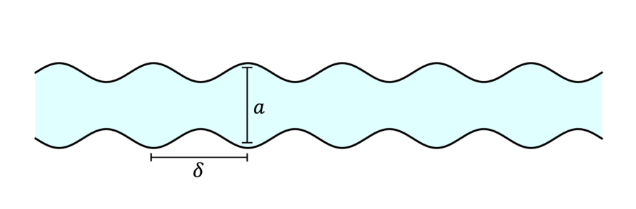

<!-- Generated by build_publications.py; do not edit by hand. -->

```{=html}
<div class="paper-info">

<p class="paper-venue"><span class="pub-journal">Communications in Mathematical Sciences</span> (2026)</p>
<p class="pub-links"><a href="https://doi.org/10.4310/cms.260326190256">Published version</a> | <a href="https://arxiv.org/abs/2410.05176">arXiv version</a></p>
<div style="clear:both"></div>
</div>
```

## Abstract

We analyze the behavior of an isentropic gas in a narrow pipe with periodically-varying cross-sectional area. Using multiple-scale perturbation theory, we derive homogenized effective equations, which take the form of a constant-coefficient system of evolution equations, including dispersive higher-order derivative terms. We provide an approximate Riemann solver for the variable-cross-section isentropic gas equations, and compare numerical solutions of the original system with those of the homogenized system. We observe that the resulting solutions take the form of solitary waves, rather than shock waves, under fairly general conditions.

<p class="abstract-source">Abstract of the arXiv version, <a href="https://arxiv.org/abs/2410.05176">arXiv:2410.05176</a>.</p>

## Code and data

Reproducibility repository: <https://github.com/laila-16/Homogenization_of_Isentropic_Gas_Equations>
