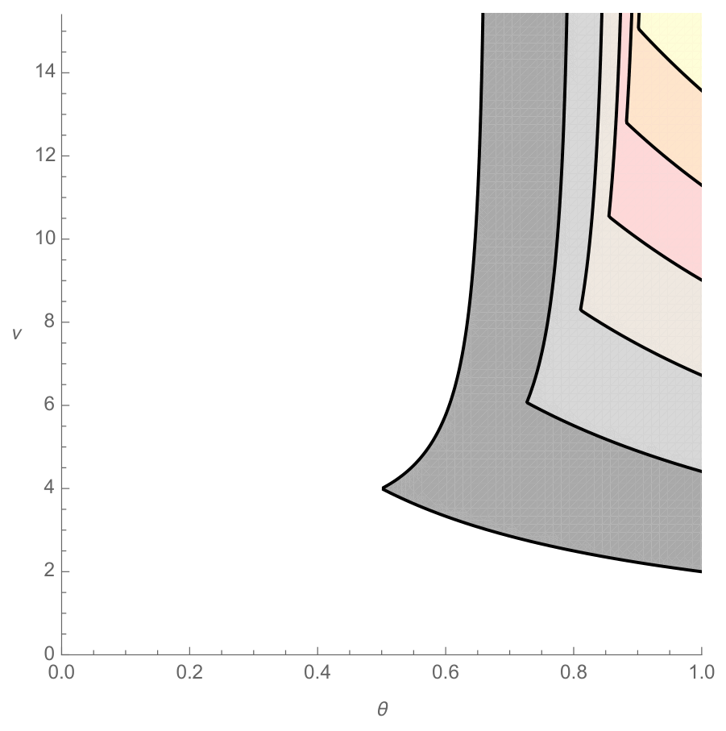

<!-- Generated by build_publications.py; do not edit by hand. -->

```{=html}
<div class="paper-info">

<p class="paper-venue">(2021)</p>
<p class="pub-links"><a href="https://arxiv.org/abs/2105.07403">arXiv version</a></p>
<div style="clear:both"></div>
</div>
```

## Abstract

We analyze, from the viewpoint of positivity preservation, certain discretizations of a fundamental partial differential equation, the one-dimensional advection equation with periodic boundary condition. The full discretization is obtained by coupling a finite difference spatial semi-discretization (the second- and some higher-order centered difference schemes, or the Fourier spectral collocation method) with an arbitrary $θ$-method in time (including the forward and backward Euler methods, and a second-order method by choosing $θ\in [0,1]$ suitably). The full discretization generates a two-parameter family of circulant matrices $M\in\mathbb{R}^{m\times m}$, where each matrix entry is a rational function in $θ$ and $ν$. Here, $ν$ denotes the CFL number, being proportional to the ratio between the temporal and spatial discretization step sizes. The entrywise non-negativity of the matrix $M$ – which is equivalent to the positivity preservation of the fully discrete scheme – is investigated via discrete Fourier analysis and also by solving some low-order parametric linear recursions. We find that positivity preservation of the fully discrete system is impossible if the number of spatial grid points $m$ is even. However, it turns out that positivity preservation of the fully discrete system is recovered for *odd* values of $m$ provided that $θ\ge 1/2$ and $ν$ are chosen suitably. These results are interesting since the systems of ordinary differential equations obtained via the spatial semi-discretizations studied are *not* positivity preserving.

<p class="abstract-source">Abstract of the arXiv version, <a href="https://arxiv.org/abs/2105.07403">arXiv:2105.07403</a>.</p>
