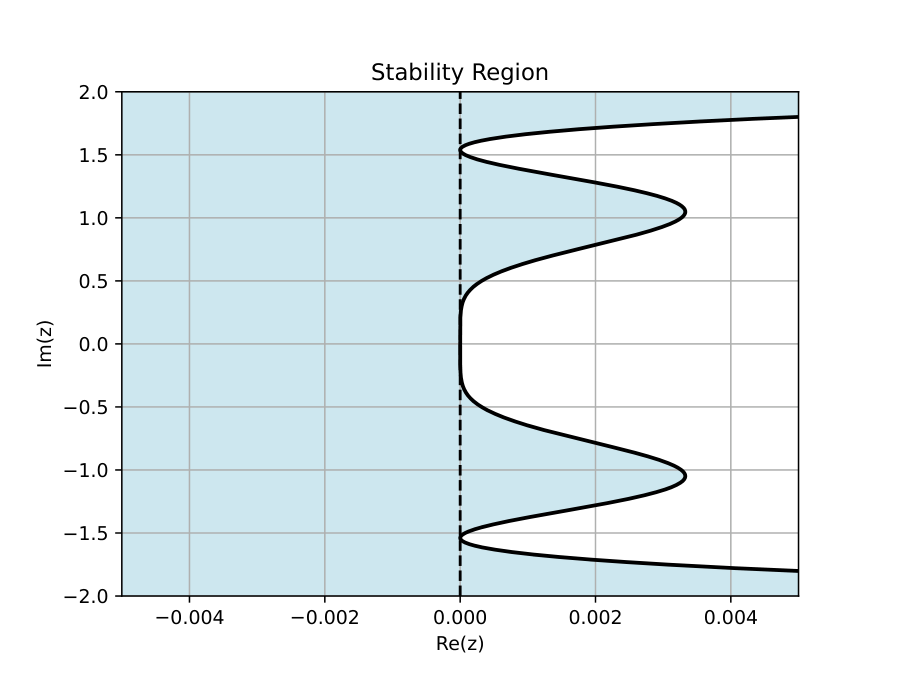

<!-- Generated by build_publications.py; do not edit by hand. -->

```{=html}
<div class="paper-info">

<p class="paper-venue"><span class="pub-journal">Numerical Algorithms</span> (2026)</p>
<p class="pub-links"><a href="https://doi.org/10.48550/arXiv.2610.22685">Published version</a> | <a href="https://arxiv.org/abs/2610.22685">arXiv version</a></p>
<div style="clear:both"></div>
</div>
```

## Abstract

We design and test several new optimized linear multistep methods for stiff problems. Each method is A-stable, implicit, and second-order accurate. We focus on achieving the smallest possible error constant while also ensuring that stiff modes are damped. We recover some known optimal L-stable three- and four-step methods, and provide new and improved five-step methods. We also develop new methods that are not L-stable but provide a prescribed rate of damping in the infinitely stiff limit. Variable-step-size formulae are also provided for some of the new methods. Numerical tests demonstrate that the improved error constants lead to improved accuracy.

<p class="abstract-source">Abstract of the arXiv version, <a href="https://arxiv.org/abs/2610.22685">arXiv:2610.22685</a>.</p>

## Code and data

Reproducibility repository: <https://github.com/tylerj32/optimized_lmms_for_stiff_problems_repository>
