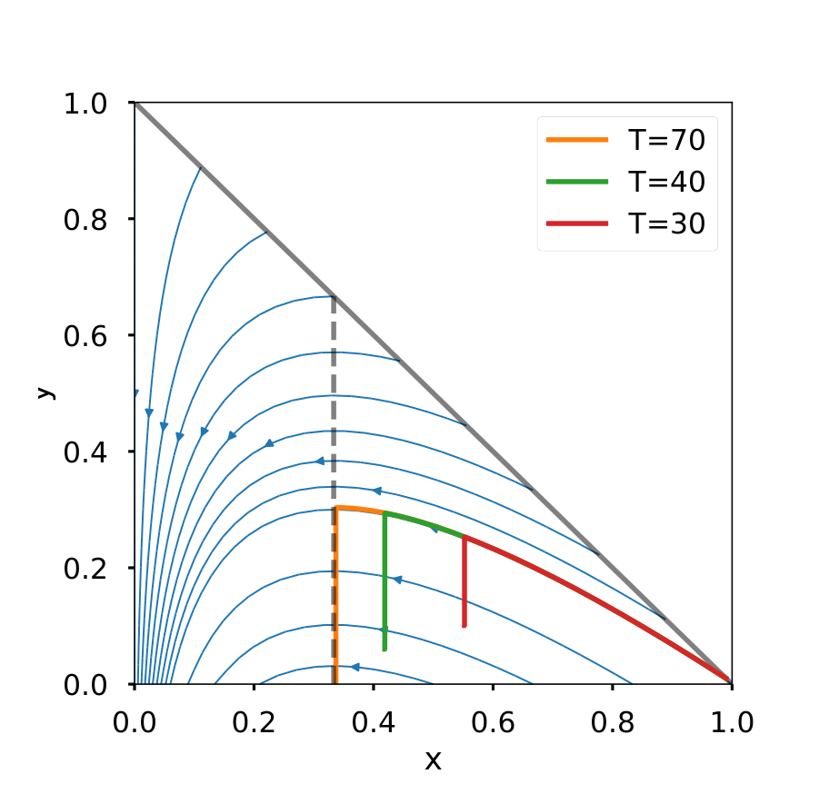

<!-- Generated by build_publications.py; do not edit by hand. -->

```{=html}
<div class="paper-info">

<p class="paper-venue"><span class="pub-journal">Journal of Mathematical Biology</span>, 83(1):1--21 (2021)</p>
<p class="pub-links"><a href="https://doi.org/10.1007/s00285-021-01628-9">Published version</a> | <a href="https://arxiv.org/abs/2004.08848">arXiv version</a></p>
<div style="clear:both"></div>
</div>
```

## Abstract

We consider the problem of controlling an SIR-model epidemic by temporarily reducing the rate of contact within a population. The control takes the form of a multiplicative reduction in the contact rate of infectious individuals. The control is allowed to be applied only over a finite time interval, while the objective is to minimize the total number of individuals infected in the long-time limit, subject to some cost function for the control. We first consider the no-cost scenario and analytically determine the optimal control and solution. We then study solutions when a cost of intervention is included, as well as a cost associated with overwhelming the available medical resources. Examples are studied through the numerical solution of the associated Hamilton-Jacobi-Bellman equation. Finally, we provide some examples related directly to the current pandemic.

<p class="abstract-source">Abstract of the arXiv version, <a href="https://arxiv.org/abs/2004.08848">arXiv:2004.08848</a>.</p>

## Code and data

Reproducibility repository: <https://github.com/ketch/SIR-control-code>
