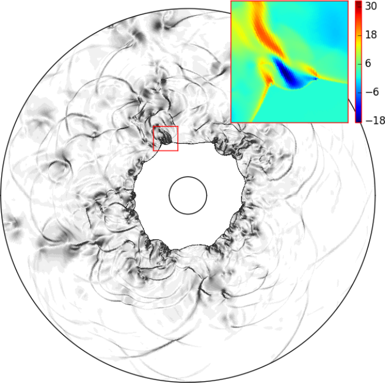

<!-- Generated by build_publications.py; do not edit by hand. -->

```{=html}
<div class="paper-info">

<p class="paper-venue"><span class="pub-journal">International Journal for Numerical Methods in Fluids</span>, 94(6):655--677 (2022)</p>
<p class="pub-links"><a href="https://doi.org/10.1002/fld.5070">Published version</a> | <a href="https://arxiv.org/abs/2103.09664">arXiv version</a></p>
<div style="clear:both"></div>
</div>
```

## Abstract

We investigate the numerical artifact known as a carbuncle, in the solution of the shallow water equations. We propose a new Riemann solver that is based on a local measure of the entropy residual and aims to avoid carbuncles while maintaining high accuracy. We propose a new challenging test problem for shallow water codes, consisting of a steady circular hydraulic jump that can be physically unstable. We show that numerical methods are prone to either suppress the instability completely or form carbuncles. We test existing cures for the carbuncle. In our experiments, only the proposed method is able to avoid unphysical carbuncles without suppressing the physical instability.

<p class="abstract-source">Abstract of the arXiv version, <a href="https://arxiv.org/abs/2103.09664">arXiv:2103.09664</a>.</p>
