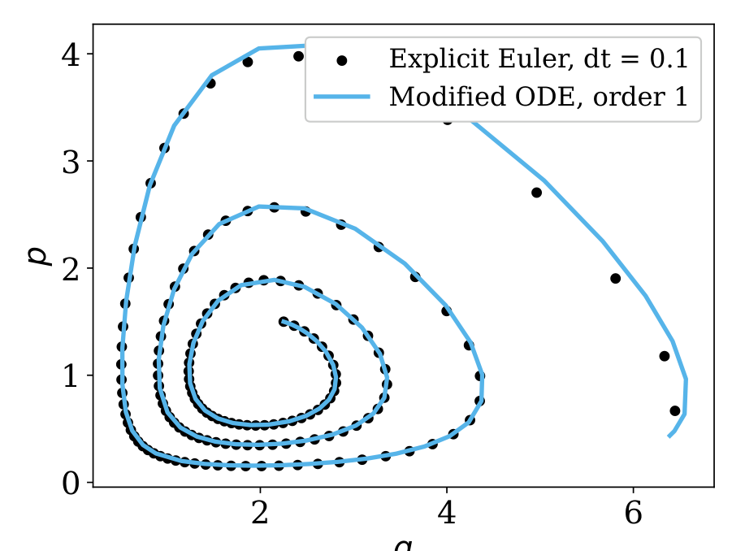

<!-- Generated by build_publications.py; do not edit by hand. -->

```{=html}
<div class="paper-info">

<p class="paper-venue"><span class="pub-journal">ACM Transactions on Mathematical Software</span>, 49(2):1--23 (2023)</p>
<p class="pub-links"><a href="https://doi.org/10.1145/3573384">Published version</a> | <a href="https://arxiv.org/abs/2111.11680">arXiv version</a></p>
<div style="clear:both"></div>
</div>
```

## Abstract

We present BSeries.jl, a Julia package for the computation and manipulation of B-series, which are a versatile theoretical tool for understanding and designing discretizations of differential equations. We give a short introduction to the theory of B-series and associated concepts and provide examples of their use, including method composition and backward error analysis. The associated software is highly performant and makes it possible to work with B-series of high order.

<p class="abstract-source">Abstract of the arXiv version, <a href="https://arxiv.org/abs/2111.11680">arXiv:2111.11680</a>.</p>

## Code and data

Reproducibility repository: <https://github.com/ketch/bseries-package-notebooks>
