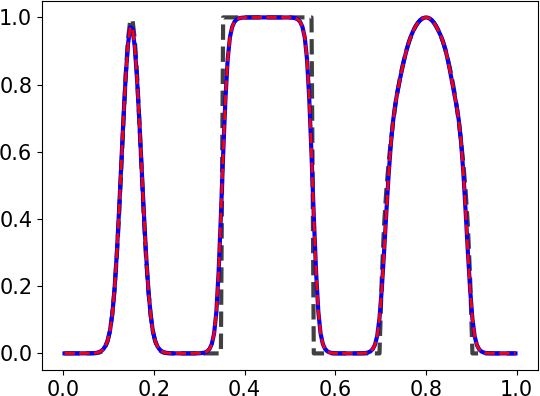

<!-- Generated by build_publications.py; do not edit by hand. -->

```{=html}
<div class="paper-info">

<p class="paper-venue"><span class="pub-journal">Journal of Scientific Computing</span>, 91(21) (2022)</p>
<p class="pub-links"><a href="https://doi.org/10.1007/s10915-022-01784-0">Published version</a> | <a href="https://arxiv.org/abs/2009.01133">arXiv version</a></p>
<div style="clear:both"></div>
</div>
```

## Abstract

We introduce a general framework for enforcing local or global maximum principles in high-order space-time discretizations of a scalar hyperbolic conservation law. We begin with sufficient conditions for a space discretization to be bound preserving (BP) and satisfy a semi-discrete maximum principle. Next, we propose a global monolithic convex (GMC) flux limiter which has the structure of a flux-corrected transport (FCT) algorithm but is applicable to spatial semi-discretizations and ensures the BP property of the fully discrete scheme for strong stability preserving (SSP) Runge-Kutta time discretizations. To circumvent the order barrier for SSP time integrators, we constrain the intermediate stages and/or the final stage of a general high-order RK method using GMC-type limiters. In this work, our theoretical and numerical studies are restricted to explicit schemes which are provably BP for sufficiently small time steps. The new GMC limiting framework offers the possibility of relaxing the bounds of inequality constraints to achieve higher accuracy at the cost of more stringent time step restrictions. The ability of the presented limiters to preserve global bounds and recognize well-resolved smooth solutions is verified numerically for three representative RK methods combined with weighted essentially nonoscillatory (WENO) finite volume space discretizations of linear and nonlinear test problems in 1D.

<p class="abstract-source">Abstract of the arXiv version, <a href="https://arxiv.org/abs/2009.01133">arXiv:2009.01133</a>.</p>
