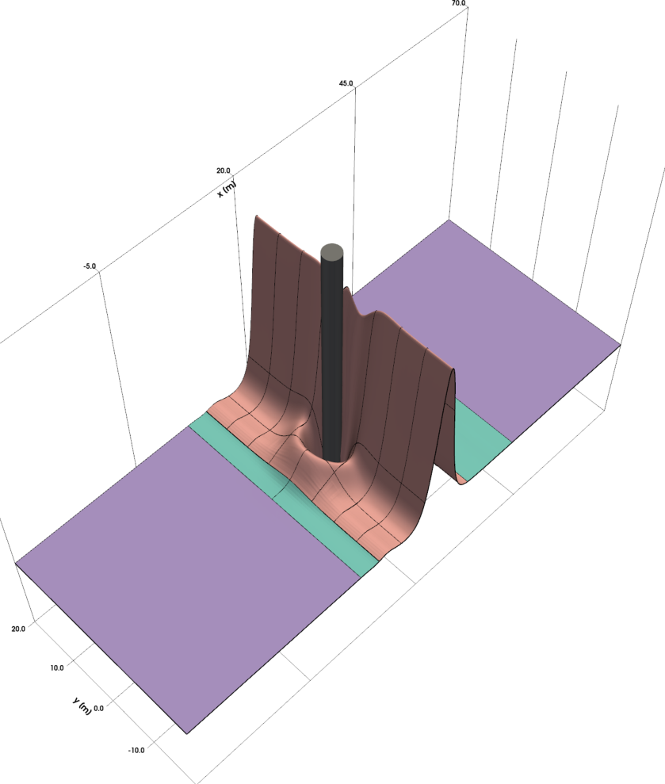

<!-- Generated by build_publications.py; do not edit by hand. -->

```{=html}
<div class="paper-info">

<p class="paper-venue"><span class="pub-journal">arXiv preprint arXiv:2606.12162</span> (2026)</p>
<p class="pub-links"><a href="https://arxiv.org/abs/2606.12162">arXiv version</a></p>
<div style="clear:both"></div>
</div>
```

## Abstract

Accurate modeling of tsunamis (such as those generated by landslides) requires capturing both wave dispersion in the deep ocean and wave breaking near the shore. The shallow water equations are often preferred for working with tsunamis, but neglect dispersion and may be inaccurate in scenarios where dispersive effects are significant. In this work, we develop an approach that seeks to incorporate the best aspects of both hyperbolic and dispersive models by combining either of two hyperbolic reformulations of the Serre-Green-Naghdi equations away from the shore with the non-dispersive shallow water equations near the shore. The model is discretized and implemented within the GeoClaw software, and incorporates adaptive mesh refinement as well as shared-memory parallelism. We validate it through comparison with benchmarks and real tsunami data. The results and performance compare favorably with the existing dispersive water wave solvers, including a speedup of about 2x relative to GeoClaw's existing dispersive solver for a large-scale tsunami simulation.

<p class="abstract-source">Abstract of the arXiv version, <a href="https://arxiv.org/abs/2606.12162">arXiv:2606.12162</a>.</p>

## Code and data

Reproducibility repository: <https://github.com/carlosmunozmoncayo/adaptive_explicit_HSGN>
