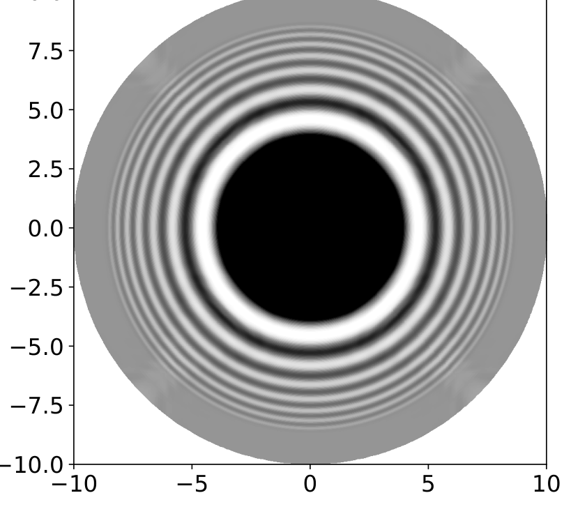

<!-- Generated by build_publications.py; do not edit by hand. -->

```{=html}
<div class="paper-info">

<p class="paper-venue"><span class="pub-journal">arXiv preprint arXiv:2611.03642</span> (2026)</p>
<p class="pub-links"><a href="https://arxiv.org/abs/2611.03642">arXiv version</a></p>
<div style="clear:both"></div>
</div>
```

## Abstract

We propose and study a first-order hyperbolic approximation of the nonlinear Schrödinger (NLS) equation in $N$ spatial dimensions. This is an extension of the recently-proposed 1D hyperbolic NLS model. We study the structure and properties of the hyperbolic approximation and their relation to those of the original system. We show that the N-dimensional hyperbolic system exactly conserves analogs of the mass, energy, and momentum, and that it possesses stationary solutions that are closely related to those of NLS. The hyperbolic system is also shown to admit plane-wave solutions that share some stability properties with those of NLS, and that relaxation can shrink the focusing low-wavenumber modulational instability band as well as introduce a high-wavenumber instability band not present in NLS. We also show that solutions of the hyperbolic system converge to solutions of NLS in the relaxation limit. We present an adaptive-mesh finite volume discretization of the hyperbolic system and demonstrate its effectiveness in handling simulations, including those with geometric obstacles or non-periodic boundary conditions. The effectiveness of the numerical scheme is demonstrated through examples including a Bose-Einstein condensate, line soliton instability, and superflow past a cylinder.

<p class="abstract-source">Abstract of the arXiv version, <a href="https://arxiv.org/abs/2611.03642">arXiv:2611.03642</a>.</p>

## Code and data

Reproducibility repository: <https://github.com/carlosmunozmoncayo/NLSH_ND>
