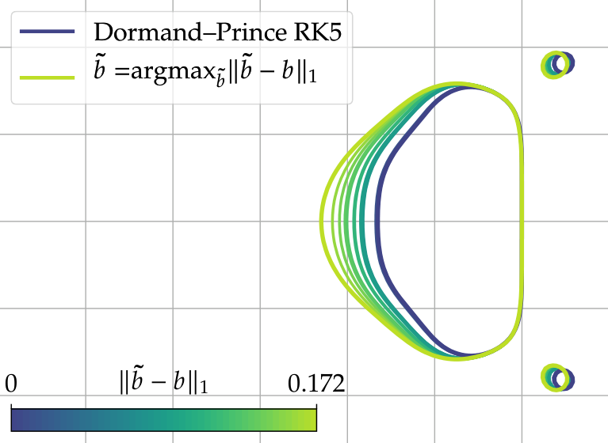

<!-- Generated by build_publications.py; do not edit by hand. -->

```{=html}
<div class="paper-info">

<p class="paper-venue"><span class="pub-journal">Communications in Applied Mathematics and Computational Science</span>, 16(2):155-179 (2021)</p>
<p class="pub-links"><a href="https://doi.org/10.2140/camcos.2021.16.155">Published version</a> | <a href="https://arxiv.org/abs/2005.06268">arXiv version</a></p>
<div style="clear:both"></div>
</div>
```

## Abstract

Many important differential equations model quantities whose value must remain positive or stay in some bounded interval. These bounds may not be preserved when the model is solved numerically. We propose to ensure positivity or other bounds by applying Runge-Kutta integration in which the method weights are adapted in order to enforce the bounds. The weights are chosen at each step after calculating the stage derivatives, in a way that also preserves (when possible) the order of accuracy of the method. The choice of weights is given by the solution of a linear program. We investigate different approaches to choosing the weights by considering adding further constraints. We also provide some analysis of the properties of Runge-Kutta methods with perturbed weights. Numerical examples demonstrate the effectiveness of the approach, including application to both stiff and non-stiff problems.

<p class="abstract-source">Abstract of the arXiv version, <a href="https://arxiv.org/abs/2005.06268">arXiv:2005.06268</a>.</p>

## Code and data

Reproducibility repository: <https://github.com/ketch/Positive_RK_Reproducibility>
