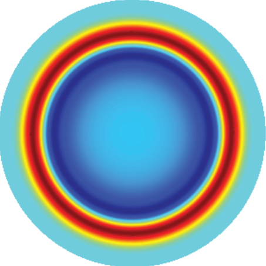

<!-- Generated by build_publications.py; do not edit by hand. -->

```{=html}
<div class="paper-info">

<p class="paper-venue">in Proceedings of the European Congress on Computational Methods in Applied Sciences and Engineering. (2012)</p>
<div style="clear:both"></div>
</div>
```
