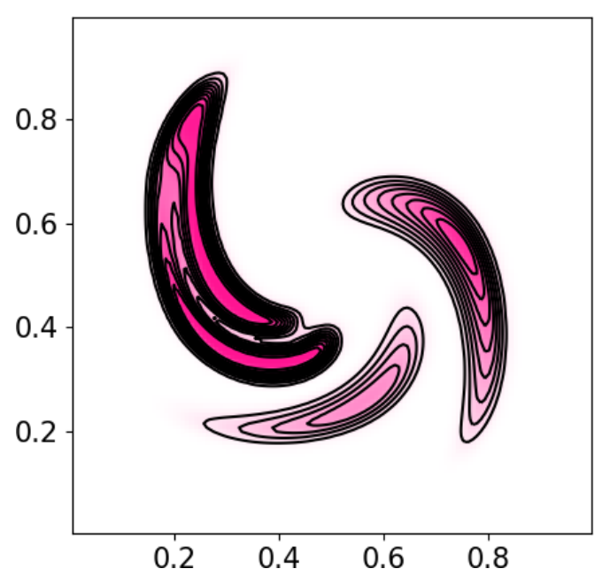

<!-- Generated by build_publications.py; do not edit by hand. -->

```{=html}
<div class="paper-info">

<p class="paper-venue"><span class="pub-journal">Journal of Scientific Computing</span>, 92(102) (2022)</p>
<p class="pub-links"><a href="https://doi.org/10.1007/s10915-022-01922-8">Published version</a> | <a href="https://arxiv.org/abs/2109.08272">arXiv version</a></p>
<div style="clear:both"></div>
</div>
```

## Abstract

We provide a framework for high-order discretizations of nonlinear scalar convection-diffusion equations that satisfy a discrete maximum principle. The resulting schemes can have arbitrarily high order accuracy in time and space, and can be stable and maximum-principle-preserving (MPP) with no step size restriction. The schemes are based on a two-tiered limiting strategy, starting with a high-order limiter-based method that may have small oscillations or maximum-principle violations, followed by an additional limiting step that removes these violations while preserving high order accuracy. The desirable properties of the resulting schemes are demonstrated through several numerical examples.

<p class="abstract-source">Abstract of the arXiv version, <a href="https://arxiv.org/abs/2109.08272">arXiv:2109.08272</a>.</p>

## Code and data

Reproducibility repository: <https://github.com/manuel-quezada/BP_Lim_for_imp_RK_Methods>
