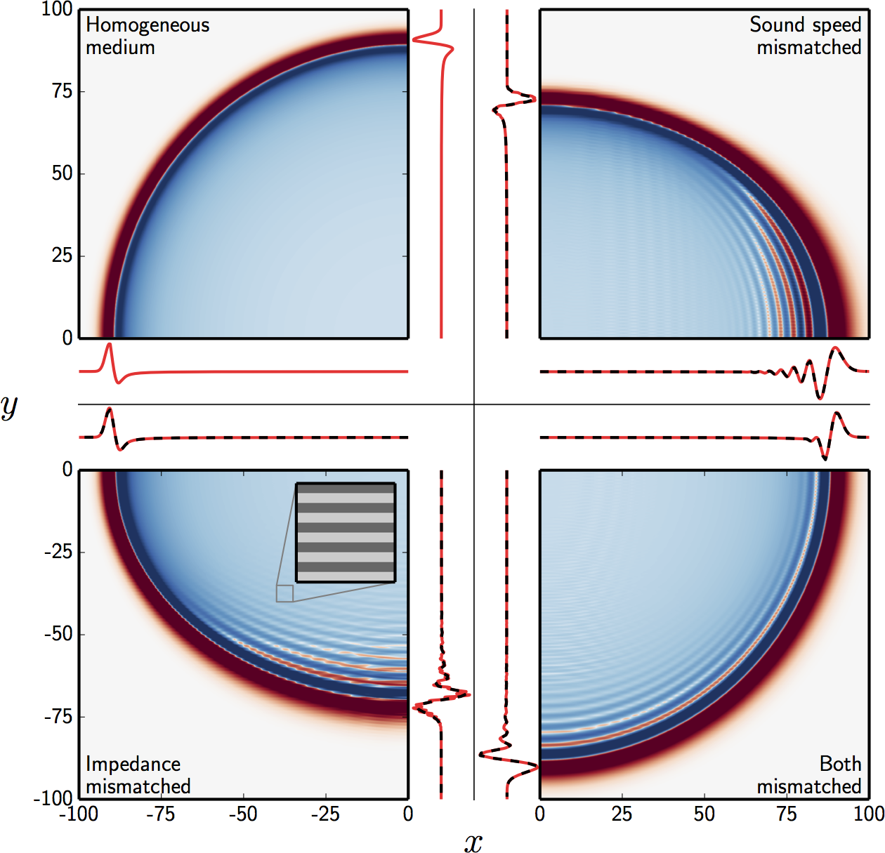

<!-- Generated by build_publications.py; do not edit by hand. -->

```{=html}
<div class="paper-info">

<p class="paper-venue"><span class="pub-journal">SIAM Journal on Applied Mathematics</span>, 74(6):1852-1869 (2014)</p>
<p class="pub-links"><a href="https://doi.org/10.1137/130937962">Published version</a> | <a href="https://arxiv.org/abs/1309.6666">arXiv version</a> | <a href="https://github.com/ketch/effective_dispersion_RR">Reproducibility repository</a></p>
<div style="clear:both"></div>
</div>
```

## Abstract

We study two-dimensional wave propagation in materials whose properties vary periodically in one direction only. High order homogenization is carried out to derive a dispersive effective medium approximation. One-dimensional materials with constant impedance exhibit no effective dispersion. We show that a new kind of effective dispersion may arise in two dimensions, even in materials with constant impedance. This dispersion is a macroscopic effect of microscopic diffraction caused by spatial variation in the sound speed. We analyze this dispersive effect by using high-order homogenization to derive an anisotropic, dispersive effective medium. We generalize to two dimensions a homogenization approach that has been used previously for one-dimensional problems. Pseudospectral solutions of the effective medium equations agree to high accuracy with finite volume direct numerical simulations of the variable-coefficient equations.

<p class="abstract-source">Abstract of the arXiv version, <a href="https://arxiv.org/abs/1309.6666">arXiv:1309.6666</a>.</p>

## Code and data

Reproducibility repository: <https://github.com/ketch/effective_dispersion_RR>
