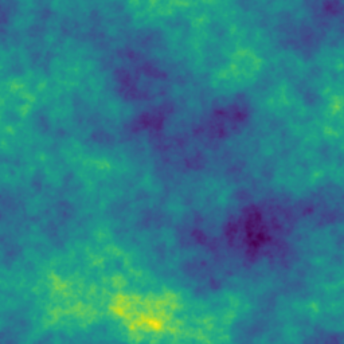

<!-- Generated by build_publications.py; do not edit by hand. -->

```{=html}
<div class="paper-info">

<p class="paper-venue"><span class="pub-journal">arXiv preprint arXiv:2604.05940</span> (2026)</p>
<p class="pub-links"><a href="https://arxiv.org/abs/2604.05940">arXiv version</a></p>
<div style="clear:both"></div>
</div>
```

## Abstract

We study relaxation-based approaches for conserving mass and energy in the numerical solution of Schrödinger-Poisson (SP) type systems. Relaxation-based methods offer a general approach that can be applied as post-time step processing to achieve conservation with any time-stepping scheme. Here we study two types of relaxation techniques applied to implicit-explicit Runge-Kutta schemes, with Fourier collocation in space. We also study SP equations with time-varying coefficients (which appear naturally in cosmology) where energy is not conserved but satisfies a balance equation. We show that the fully-discrete system conserves both mass and energy (or satisfies the balance equation in case of time-varying coefficients), up to rounding errors. The effectiveness of these methods is demonstrated via numerical examples, including a three-dimensional cosmological simulation.

<p class="abstract-source">Abstract of the arXiv version, <a href="https://arxiv.org/abs/2604.05940">arXiv:2604.05940</a>.</p>

## Code and data

Reproducibility repository: <https://github.com/manu0x/Conservative-Schrodinger-Poisson-ImEx>
