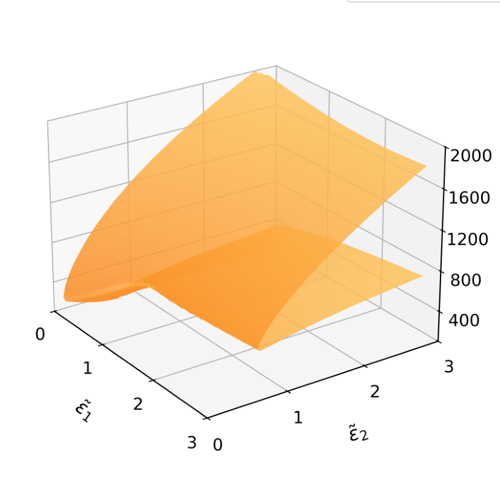

<!-- Generated by build_publications.py; do not edit by hand. -->

```{=html}
<div class="paper-info">

<p class="paper-venue"><span class="pub-journal">arXiv preprint arXiv:2610.01111</span> (2026)</p>
<p class="pub-links"><a href="https://arxiv.org/abs/2610.01111">arXiv version</a></p>
<div style="clear:both"></div>
</div>
```

## Abstract

We propose and study a compartmental epidemiological model that incorporates both waning immunity and mutation-driven immune escape into a single-strain framework. The model, termed SIRCm, extends the SIRC (Susceptible-Infected-Recovered-Cross-immune) model, in which recovered individuals pass through an intermediate cross-immune class before returning to full susceptibility. In SIRCm, both the rate of immune waning and the rate of immune escape are amplified by a feedback function tied to the current level of infection. We study two formulations of this feedback, a transmission-driven model, in which mutation opportunities arise at the point of new infection, and a prevalence-driven model, in which they arise in proportion to the infected population alone. For both models and any feedback strength, we prove existence of an endemic equilibrium using persistence theory, and characterize its behavior analytically in the weak and strong-feedback limits, recovering the SIRC and SIS models, respectively, as limiting cases. Unlike the SIRC model, we show that the SIRCm endemic equilibrium is unstable in certain parameter regimes. This leads to novel behavior, even in the absence of seasonal forcing.

<p class="abstract-source">Abstract of the arXiv version, <a href="https://arxiv.org/abs/2610.01111">arXiv:2610.01111</a>.</p>

## Code and data

Reproducibility repository: <https://github.com/danielarenee/infection-modeling-with-mutation>
