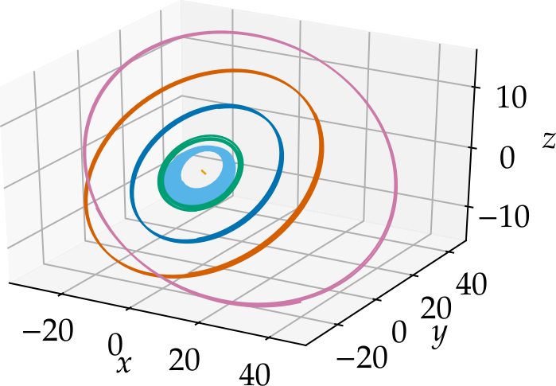

<!-- Generated by build_publications.py; do not edit by hand. -->

```{=html}
<div class="paper-info">

<p class="paper-venue"><span class="pub-journal">Journal of Scientific Computing</span>, 84 (2020)</p>
<p class="pub-links"><a href="https://doi.org/10.1007/s10915-020-01277-y">Published version</a> | <a href="https://arxiv.org/abs/2001.04826">arXiv version</a></p>
<div style="clear:both"></div>
</div>
```

## Abstract

The recently-introduced relaxation approach for Runge-Kutta methods can be used to enforce conservation of energy in the integration of Hamiltonian systems. We study the behavior of implicit and explicit relaxation Runge-Kutta methods in this context. We find that, in addition to their useful conservation property, the relaxation methods yield other improvements. Experiments show that their solutions bear stronger qualitative similarity to the true solution and that the error grows more slowly in time. We also prove that these methods are superconvergent for a certain class of Hamiltonian systems.

<p class="abstract-source">Abstract of the arXiv version, <a href="https://arxiv.org/abs/2001.04826">arXiv:2001.04826</a>.</p>

## Code and data

Reproducibility repository: <https://github.com/ranocha/Hamiltonian-RRK-notebooks>
