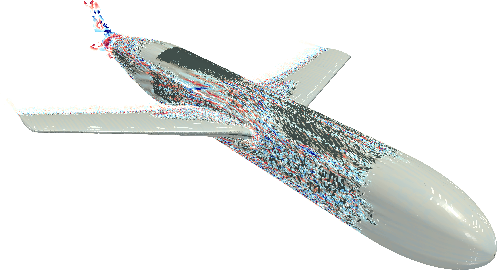

<!-- Generated by build_publications.py; do not edit by hand. -->

```{=html}
<div class="paper-info">

<p class="paper-venue"><span class="pub-journal">Communications on Applied Mathematics and Computation</span>, 4(4):1191--1228 (2022)</p>
<p class="pub-links"><a href="https://doi.org/10.1007/s42967-021-00159-w">Published version</a> | <a href="https://arxiv.org/abs/2104.06836">arXiv version</a></p>
<div style="clear:both"></div>
</div>
```

## Abstract

We develop error-control based time integration algorithms for compressible fluid dynamics (CFD) applications and show that they are efficient and robust in both the accuracy-limited and stability-limited regime. Focusing on discontinuous spectral element semidiscretizations, we design new controllers for existing methods and for some new embedded Runge-Kutta pairs. We demonstrate the importance of choosing adequate controller parameters and provide a means to obtain these in practice. We compare a wide range of error-control-based methods, along with the common approach in which step size control is based on the Courant-Friedrichs-Lewy (CFL) number. The optimized methods give improved performance and naturally adopt a step size close to the maximum stable CFL number at loose tolerances, while additionally providing control of the temporal error at tighter tolerances. The numerical examples include challenging industrial CFD applications.

<p class="abstract-source">Abstract of the arXiv version, <a href="https://arxiv.org/abs/2104.06836">arXiv:2104.06836</a>.</p>

## Code and data

Reproducibility repository: <https://github.com/ranocha/Optimized-RK-CFD>
