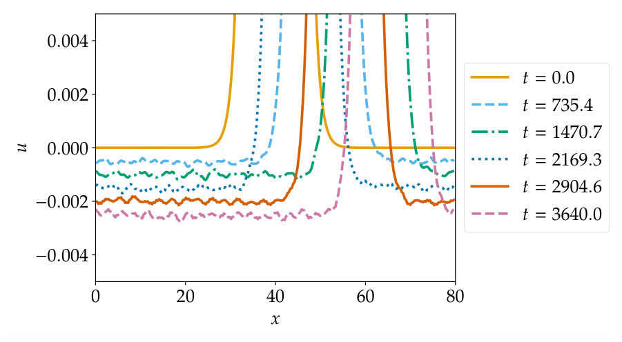

<!-- Generated by build_publications.py; do not edit by hand. -->

```{=html}
<div class="paper-info">

<p class="paper-venue"><span class="pub-journal">Partial Differential Equations and Applications</span>, 2(6):1--26 Accepted. (2021)</p>
<p class="pub-links"><a href="https://doi.org/10.1007/s42985-021-00126-3">Published version</a> | <a href="https://arxiv.org/abs/2102.07376">arXiv version</a></p>
<div style="clear:both"></div>
</div>
```

## Abstract

We study the numerical error in solitary wave solutions of nonlinear dispersive wave equations. A number of existing results for discretizations of solitary wave solutions of particular equations indicate that the error grows quadratically in time for numerical methods that do not conserve energy, but grows only linearly for conservative methods. We provide numerical experiments suggesting that this result extends to a very broad class of equations and numerical methods.

<p class="abstract-source">Abstract of the arXiv version, <a href="https://arxiv.org/abs/2102.07376">arXiv:2102.07376</a>.</p>

## Code and data

Reproducibility repository: <https://github.com/ranocha/Dispersive-wave-error-growth-notebooks>
