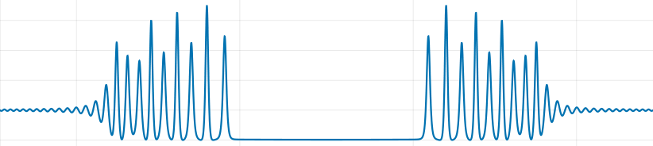

<!-- Generated by build_publications.py; do not edit by hand. -->

```{=html}
<div class="paper-info">

<p class="paper-venue"><span class="pub-journal">arXiv preprint arXiv:2510.14335</span> (2025)</p>
<p class="pub-links"><a href="https://arxiv.org/abs/2510.14335">arXiv version</a></p>
<div style="clear:both"></div>
</div>
```

## Abstract

We propose a class of numerical methods for the nonlinear Schrödinger (NLS) equation that conserves mass and energy, is of arbitrarily high-order accuracy in space and time, and requires only the solution of a scalar algebraic equation per time step. We show that some existing spatial discretizations, including the popular Fourier spectral method, are in fact energy-conserving if one considers the appropriate form of the energy density. We develop a new relaxation-type approach for conserving multiple nonlinear functionals that is more efficient and robust for the NLS equation compared to the existing multiple-relaxation approach. The accuracy and efficiency of the new schemes is demonstrated on test problems for both the focusing and defocusing NLS.

<p class="abstract-source">Abstract of the arXiv version, <a href="https://arxiv.org/abs/2510.14335">arXiv:2510.14335</a>.</p>

## Code and data

Reproducibility repository: <https://github.com/ranocha/2025_nls>
