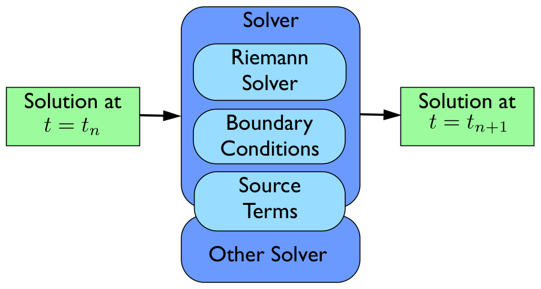

<!-- Generated by build_publications.py; do not edit by hand. -->

```{=html}
<div class="paper-info">

<p class="paper-venue">in Proceedings of SciPy 2011. (2011)</p>
<p class="pub-links"><a href="http://conference.scipy.org/proceedings/scipy2011/pdfs/mandli_etal.pdf">Paper</a> | <a href="https://doi.org/10.25080/majora-ebaa42b7-00c">Published version</a></p>
<div style="clear:both"></div>
</div>
```
