<!-- Generated by build_publications.py; do not edit by hand. -->

<div class="pub-controls">
<input type="search" id="pub-search" placeholder="Search by title or author" aria-label="Search publications">
<div class="pub-filters" role="group" aria-label="Filter by topic">
<button class="pub-filter active" data-filter="all">All</button>
<button class="pub-filter" data-filter="time-integration">Time integration</button>
<button class="pub-filter" data-filter="periodic-media">Waves in periodic media</button>
<button class="pub-filter" data-filter="hyperbolic">Hyperbolic PDEs</button>
<button class="pub-filter" data-filter="ssp">Strong stability preservation</button>
<button class="pub-filter" data-filter="runge-kutta">Runge-Kutta methods</button>
<button class="pub-filter" data-filter="epidemiology">Epidemiology</button>
</div>
<p id="pub-count"></p>
</div>

```{=html}
<div id="pub-list">
<h2>Submitted preprints</h2>
<div class="pub filterable time-integration runge-kutta">
<a href="/papers/rajvanshi2026efficient/">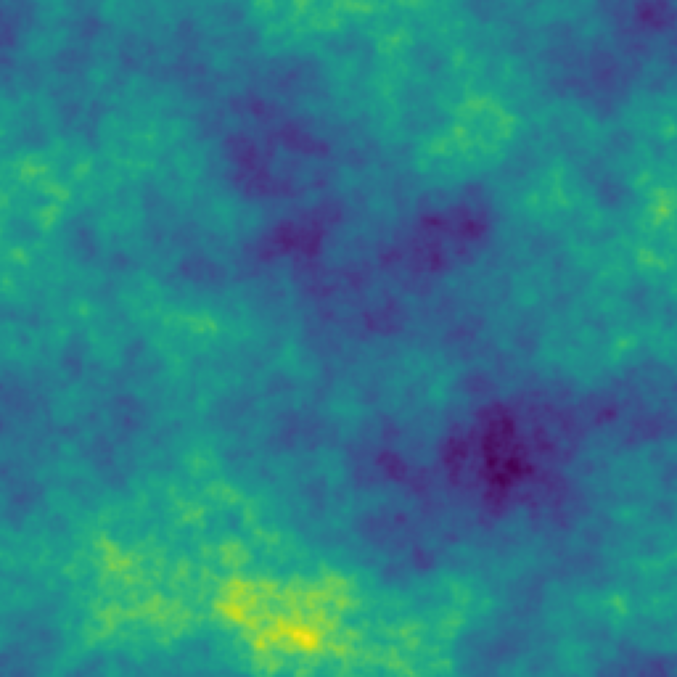</a>
<a href="/papers/rajvanshi2026efficient/"><span class="pub-title">Efficient High-order Mass-conserving and Energy-balancing Schemes for Schrödinger-Poisson Equations</span></a><br>
<span class="pub-authors">Manvendra Pratap Rajvanshi  and David I Ketcheson</span>,
<span class="pub-journal">arXiv preprint arXiv:2604.05940</span> (2026)<br>
<span class="pub-links"><a href="/papers/rajvanshi2026efficient/">More information</a> | <a href="https://arxiv.org/abs/2604.05940">arXiv version</a> | <a href="https://github.com/manu0x/Conservative-Schrodinger-Poisson-ImEx">Reproducibility repository</a></span><div style="clear:both"></div>

</div>

<div class="pub filterable hyperbolic">
<a href="/papers/munoz2026adaptive/">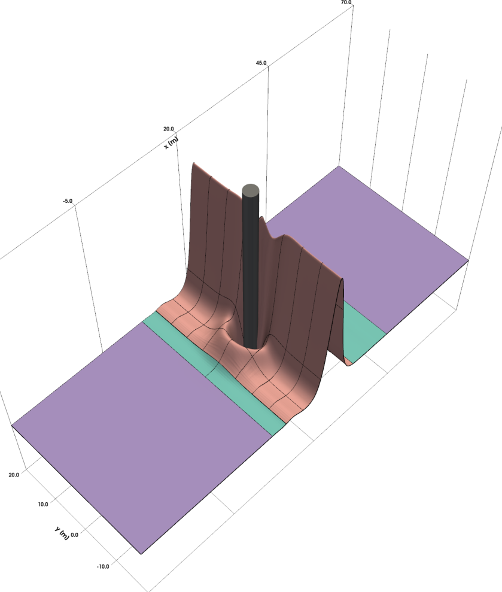</a>
<a href="/papers/munoz2026adaptive/"><span class="pub-title">Adaptive, efficient, and scalable water wave modeling with dispersive hyperbolic systems</span></a><br>
<span class="pub-authors">Carlos Muñoz-Moncayo  and David I Ketcheson</span>,
<span class="pub-journal">arXiv preprint arXiv:2606.12162</span> (2026)<br>
<span class="pub-links"><a href="/papers/munoz2026adaptive/">More information</a> | <a href="https://arxiv.org/abs/2606.12162">arXiv version</a> | <a href="https://github.com/carlosmunozmoncayo/adaptive_explicit_HSGN">Reproducibility repository</a></span><div style="clear:both"></div>

</div>

<div class="pub filterable hyperbolic time-integration">
<a href="/papers/biswas2026asymptotic/">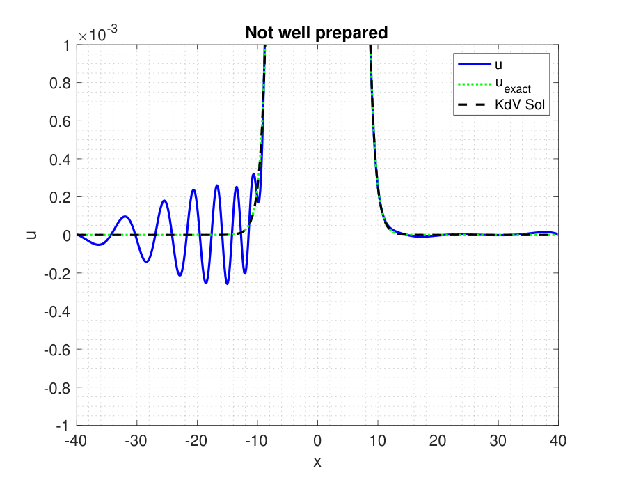</a>
<a href="/papers/biswas2026asymptotic/"><span class="pub-title">Asymptotic-Preserving Exponential Integrators applied to the Hyperbolic Korteweg-de Vries System</span></a><br>
<span class="pub-authors">Abhijit Biswas, Sebastiano Boscarino, David I Ketcheson,  and Giovanni Russo</span>,
<span class="pub-journal">arXiv preprint arXiv:2609.22864</span> (2026)<br>
<span class="pub-links"><a href="/papers/biswas2026asymptotic/">More information</a> | <a href="https://arxiv.org/abs/2609.22864">arXiv version</a> | <a href="https://github.com/abhibsws/AP_Exp_Int_KdVH_RR">Reproducibility repository</a></span><div style="clear:both"></div>

</div>

<div class="pub filterable epidemiology">
<a href="/papers/ramirez2026compartmental/">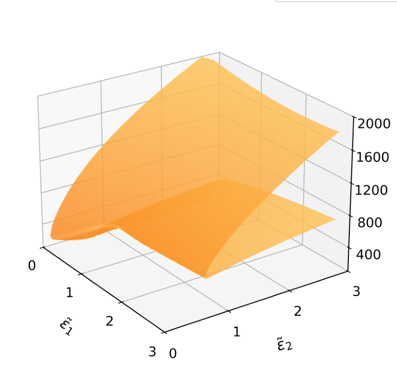</a>
<a href="/papers/ramirez2026compartmental/"><span class="pub-title">Compartmental epidemiological models with infection-driven immune escape</span></a><br>
<span class="pub-authors">Daniela R Ramírez-Gutiérrez, Lajos Lóczi, Carlos Muñoz-Moncayo,  and David I Ketcheson</span>,
<span class="pub-journal">arXiv preprint arXiv:2610.01111</span> (2026)<br>
<span class="pub-links"><a href="/papers/ramirez2026compartmental/">More information</a> | <a href="https://arxiv.org/abs/2610.01111">arXiv version</a> | <a href="https://github.com/danielarenee/infection-modeling-with-mutation">Reproducibility repository</a></span><div style="clear:both"></div>

</div>

<div class="pub filterable hyperbolic">
<a href="/papers/munoz2026hyperbolic/">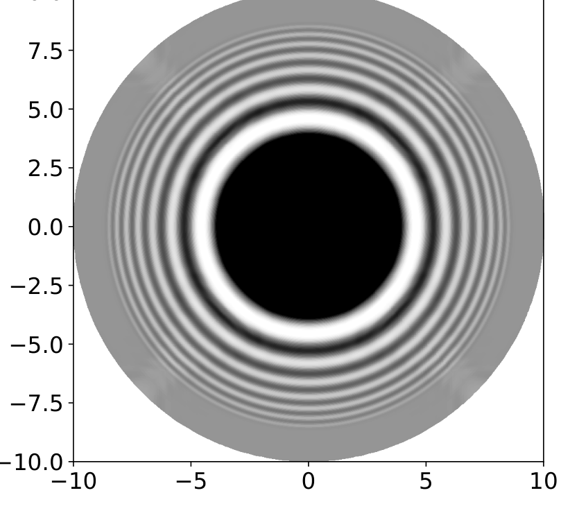</a>
<a href="/papers/munoz2026hyperbolic/"><span class="pub-title">A hyperbolic nonlinear Schrödinger system in multiple spatial dimensions: structure, convergence, and numerical discretization</span></a><br>
<span class="pub-authors">Carlos Muñoz-Moncayo, Abhijit Biswas, David I Ketcheson,  and Manvendra Rajvanshi</span>,
<span class="pub-journal">arXiv preprint arXiv:2611.03642</span> (2026)<br>
<span class="pub-links"><a href="/papers/munoz2026hyperbolic/">More information</a> | <a href="https://arxiv.org/abs/2611.03642">arXiv version</a> | <a href="https://github.com/carlosmunozmoncayo/NLSH_ND">Reproducibility repository</a></span><div style="clear:both"></div>

</div>

<div class="pub filterable time-integration hyperbolic">
<a href="/papers/ranocha2025high/">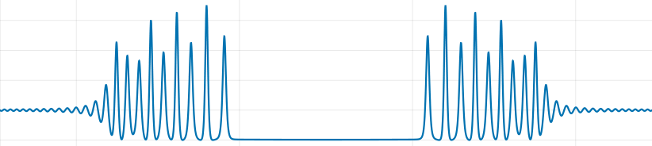</a>
<a href="/papers/ranocha2025high/"><span class="pub-title">High-order mass-and energy-conserving methods for the nonlinear Schrödinger equation and its hyperbolization</span></a><br>
<span class="pub-authors">Hendrik Ranocha  and David I Ketcheson</span>,
<span class="pub-journal">arXiv preprint arXiv:2510.14335</span> (2025)<br>
<span class="pub-links"><a href="/papers/ranocha2025high/">More information</a> | <a href="https://arxiv.org/abs/2510.14335">arXiv version</a> | <a href="https://github.com/ranocha/2025_nls">Reproducibility repository</a></span><div style="clear:both"></div>

</div>

<div class="pub filterable hyperbolic time-integration">
<a href="/papers/hadjimichael2021positivity/">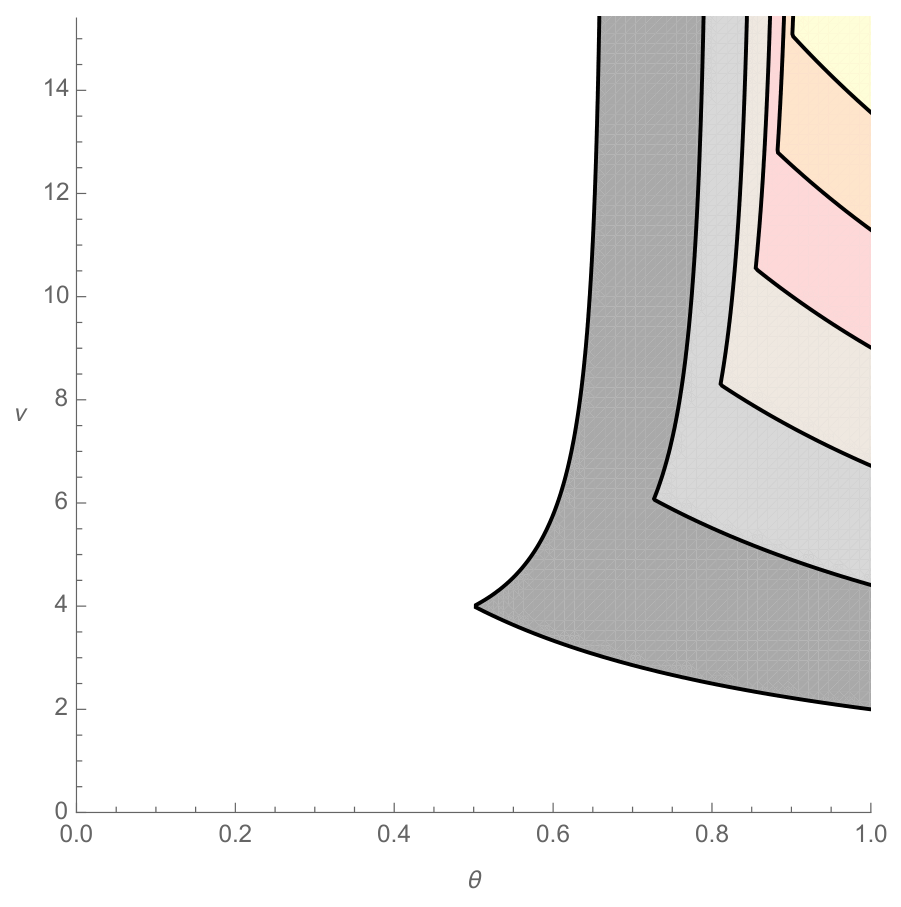</a>
<a href="/papers/hadjimichael2021positivity/"><span class="pub-title">Positivity preservation of implicit discretizations of the advection equation</span></a><br>
<span class="pub-authors">Yiannis Hadjimichael, David I. Ketcheson,  and Lajos Lóczi</span>,
 (2021)<br>
<span class="pub-links"><a href="/papers/hadjimichael2021positivity/">More information</a> | <a href="https://arxiv.org/abs/2105.07403">arXiv version</a></span><div style="clear:both"></div>

</div>

<h2>Refereed Journal Articles</h2>
<div class="pub filterable time-integration">
<a href="/papers/jensen2026optimized/">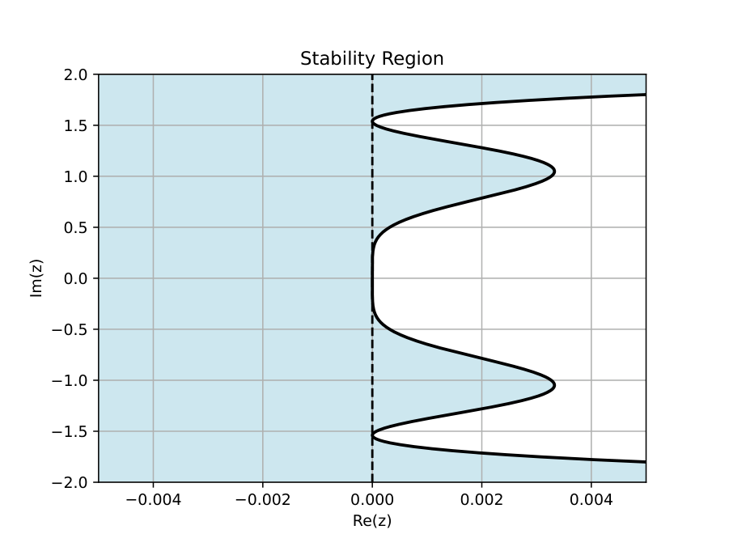</a>
<a href="/papers/jensen2026optimized/"><span class="pub-title">Optimized linear multistep methods for stiff problems</span></a><br>
<span class="pub-authors">Tyler Jensen, David I Ketcheson,  and Lajos Lóczi</span>,
<span class="pub-journal">Numerical Algorithms</span> (2026)<br>
<span class="pub-links"><a href="/papers/jensen2026optimized/">More information</a> | <a href="https://doi.org/10.48550/arXiv.2610.22685">Published version</a> | <a href="https://arxiv.org/abs/2610.22685">arXiv version</a> | <a href="https://github.com/tylerj32/optimized_lmms_for_stiff_problems_repository">Reproducibility repository</a></span><div style="clear:both"></div>

</div>

<div class="pub filterable time-integration">
<a href="/papers/ranocha2026conserving/"><span class="pub-title">Conserving mass, momentum, and energy for the Benjamin-Bona-Mahony, Korteweg-de Vries, and nonlinear Schrödinger equations</span></a><br>
<span class="pub-authors">Hendrik Ranocha  and David I. Ketcheson</span>,
<span class="pub-journal">SIAM Journal on Scientific Computing</span>, 48(4):A2314--A2341 (2026)<br>
<span class="pub-links"><a href="/papers/ranocha2026conserving/">More information</a> | <a href="https://doi.org/10.1137/25M183314X">Published version</a> | <a href="https://arxiv.org/abs/2512.16352">arXiv version</a> | <a href="https://github.com/ranocha/2025_BBM_KdV_NLS">Reproducibility repository</a></span><div style="clear:both"></div>

</div>

<div class="pub filterable periodic-media hyperbolic">
<a href="/papers/busaleh2024homogenized/">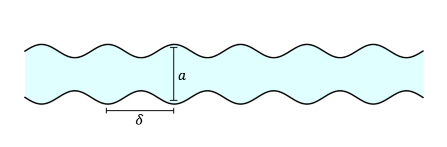</a>
<a href="/papers/busaleh2024homogenized/"><span class="pub-title">Homogenized equations for isentropic gas in a pipe with periodically-varying cross-section</span></a><br>
<span class="pub-authors">Laila S Busaleh  and David I Ketcheson</span>,
<span class="pub-journal">Communications in Mathematical Sciences</span> (2026)<br>
<span class="pub-links"><a href="/papers/busaleh2024homogenized/">More information</a> | <a href="https://doi.org/10.4310/cms.260326190256">Published version</a> | <a href="https://arxiv.org/abs/2410.05176">arXiv version</a> | <a href="https://github.com/laila-16/Homogenization_of_Isentropic_Gas_Equations">Reproducibility repository</a></span><div style="clear:both"></div>

</div>

<div class="pub filterable hyperbolic time-integration">
<a href="/papers/biswas2025hyperbolic/">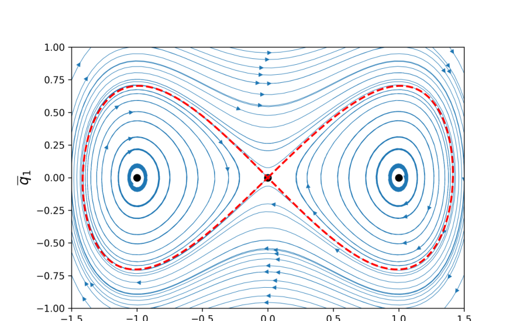</a>
<a href="/papers/biswas2025hyperbolic/"><span class="pub-title">A Hyperbolic Approximation of the Nonlinear Schrödinger Equation</span></a><br>
<span class="pub-authors">Abhijit Biswas, Laila S Busaleh, David I Ketcheson, Carlos Muñoz-Moncayo,  and Manvendra Rajvanshi</span>,
<span class="pub-journal">Studies in Applied Mathematics</span>, 155(4):e70129 (2025)<br>
<span class="pub-links"><a href="/papers/biswas2025hyperbolic/">More information</a> | <a href="https://doi.org/10.1111/sapm.70129">Published version</a> | <a href="https://arxiv.org/abs/2505.21424">arXiv version</a> | <a href="https://github.com/ketch/2025_NLSH_reproducibility">Reproducibility repository</a></span><div style="clear:both"></div>

</div>

<div class="pub filterable hyperbolic time-integration runge-kutta">
<a href="/papers/bleecke2025asymptotic/">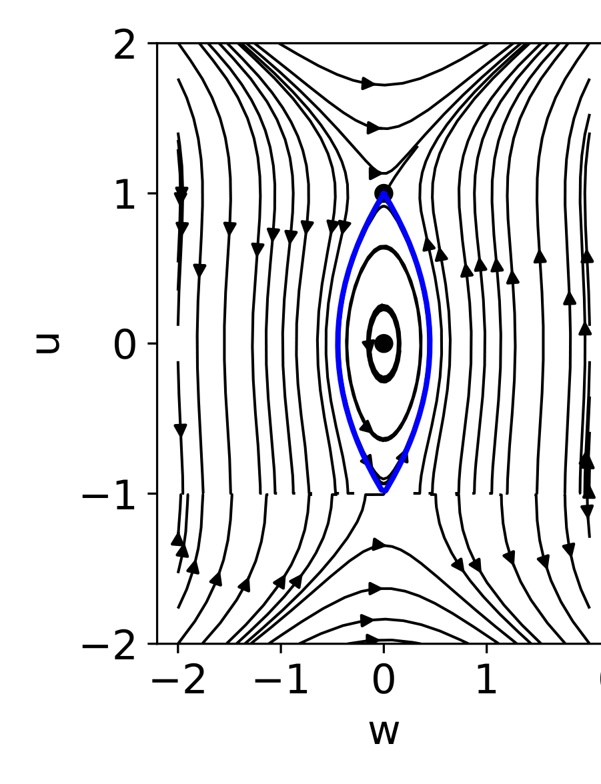</a>
<a href="/papers/bleecke2025asymptotic/"><span class="pub-title">Asymptotic-preserving and energy-conserving methods for a hyperbolic approximation of the BBM equation</span></a><br>
<span class="pub-authors">Sebastian Bleecke, Abhijit Biswas, David I Ketcheson, Hendrik Ranocha,  and Jochen Schutz</span>,
<span class="pub-journal">Communications on Applied Mathematics and Computation</span> (2025)<br>
<span class="pub-links"><a href="/papers/bleecke2025asymptotic/">More information</a> | <a href="https://doi.org/10.48550/arXiv.2511.10044">Published version</a> | <a href="https://arxiv.org/abs/2511.10044">arXiv version</a> | <a href="https://github.com/sbleecke/2025_bbmh">Reproducibility repository</a></span><div style="clear:both"></div>

</div>

<div class="pub filterable time-integration runge-kutta">
<a href="/papers/biswas2025explicit/"><span class="pub-title">Explicit Runge-Kutta methods that alleviate order reduction</span></a><br>
<span class="pub-authors">Abhijit Biswas, David I Ketcheson, Steven Roberts, Benjamin Seibold,  and David Shirokoff</span>,
<span class="pub-journal">SIAM Journal on Numerical Analysis</span>, 63(4):1398-1426 (2025)<br>
<span class="pub-links"><a href="/papers/biswas2025explicit/">More information</a> | <a href="https://doi.org/10.1137/23M1606812">Published version</a> | <a href="https://arxiv.org/abs/2310.02817">arXiv version</a> | <a href="https://github.com/abhibsws/High_WSO_ERK_Methods">Reproducibility repository</a></span><div style="clear:both"></div>

</div>

<div class="pub filterable hyperbolic">
<a href="/papers/2025_hyperbolization/">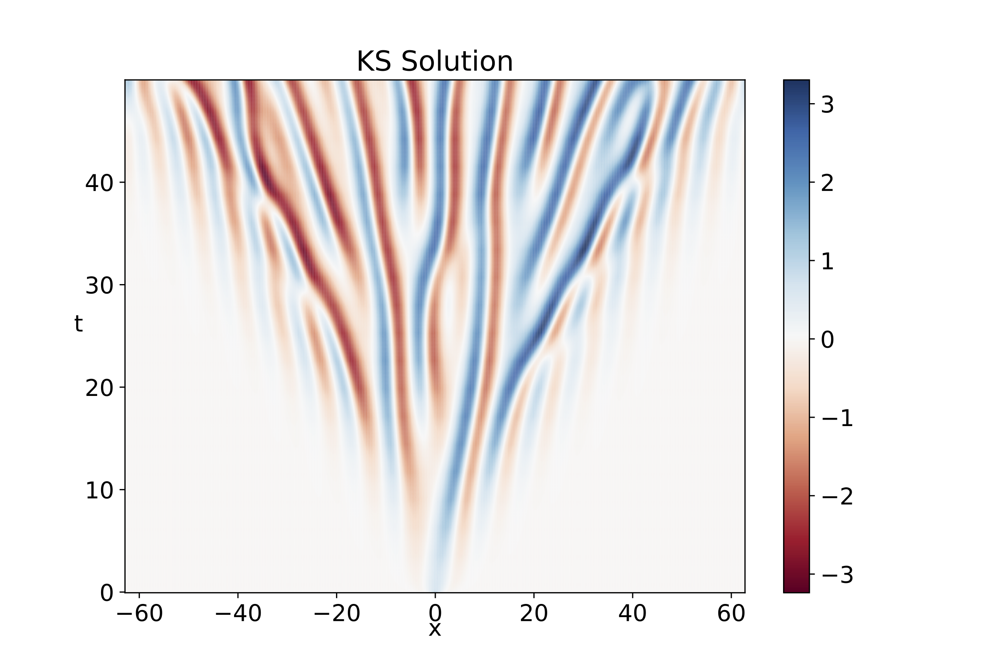</a>
<a href="/papers/2025_hyperbolization/"><span class="pub-title">Approximation of arbitrarily high-order PDEs by first-order hyperbolic relaxation</span></a><br>
<span class="pub-authors">David I Ketcheson  and Abhijit Biswas</span>,
<span class="pub-journal">Nonlinearity</span>, 38(5):055002 (2025)<br>
<span class="pub-links"><a href="/papers/2025_hyperbolization/">More information</a> | <a href="https://doi.org/10.1088/1361-6544/adc6e8">Published version</a> | <a href="https://arxiv.org/abs/2405.16841">arXiv version</a> | <a href="https://github.com/ketch/hyperbolization-RR">Reproducibility repository</a></span><div style="clear:both"></div>

</div>

<div class="pub filterable time-integration runge-kutta">
<a href="/papers/barrios2025pseudo/">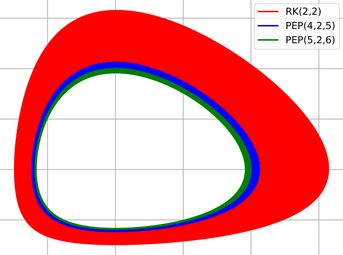</a>
<a href="/papers/barrios2025pseudo/"><span class="pub-title">Pseudo-energy-preserving explicit Runge–Kutta methods</span></a><br>
<span class="pub-authors">Gabriel A León, David I Ketcheson,  and Hendrik Ranocha</span>,
<span class="pub-journal">ESAIM: Mathematical Modelling and Numerical Analysis</span>, 59(2):729--748 (2025)<br>
<span class="pub-links"><a href="/papers/barrios2025pseudo/">More information</a> | <a href="https://doi.org/10.1051/m2an/2025002">Published version</a> | <a href="https://arxiv.org/abs/2407.15365">arXiv version</a> | <a href="https://github.com/Sondar74/PEP_Reproducibility2024">Reproducibility repository</a></span><div style="clear:both"></div>

</div>

<div class="pub filterable periodic-media hyperbolic">
<a href="/papers/2025_sw2d_homogenization/">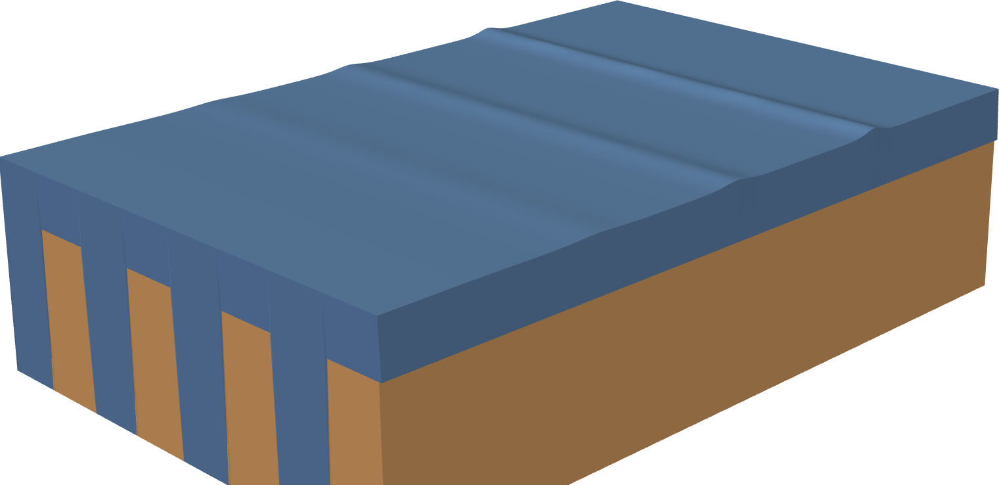</a>
<a href="/papers/2025_sw2d_homogenization/"><span class="pub-title">A dispersive effective equation for transverse propagation of planar shallow water waves over periodic bathymetry</span></a><br>
<span class="pub-authors">David I Ketcheson  and Giovanni Russo</span>,
<span class="pub-journal">Journal of Nonlinear Waves</span>, 1 (2025)<br>
<span class="pub-links"><a href="/papers/2025_sw2d_homogenization/">More information</a> | <a href="https://doi.org/10.1017/jnw.2025.1">Published version</a> | <a href="https://arxiv.org/abs/2409.00076">arXiv version</a> | <a href="https://github.com/ketch/Shallow_water_2D_homogenization_RR">Reproducibility repository</a></span><div style="clear:both"></div>

</div>

<div class="pub filterable periodic-media hyperbolic">
<a href="/papers/2025_Euler_homogenization/">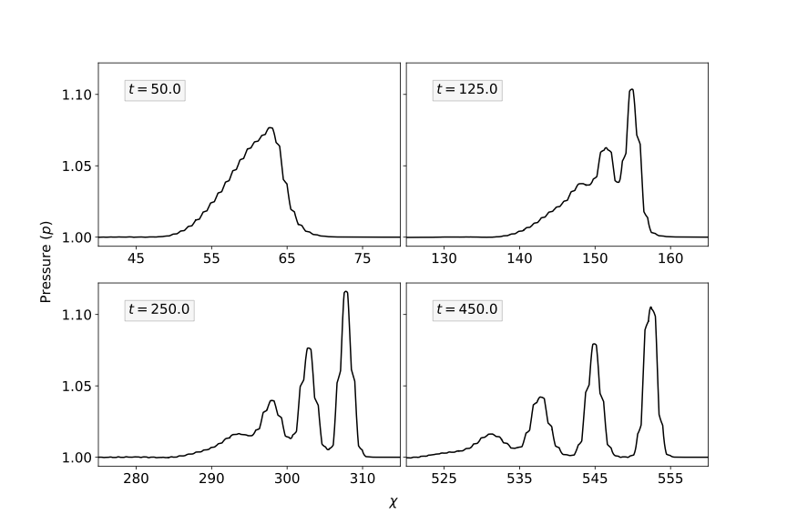</a>
<a href="/papers/2025_Euler_homogenization/"><span class="pub-title">Solitary wave formation in the compressible Euler equations</span></a><br>
<span class="pub-authors">David I Ketcheson  and Giovanni Russo</span>,
<span class="pub-journal">Multiscale Modeling & Simulation</span>, 24(1):187--213 (2025)<br>
<span class="pub-links"><a href="/papers/2025_Euler_homogenization/">More information</a> | <a href="https://doi.org/10.1137/24M1712527">Published version</a> | <a href="https://arxiv.org/abs/2412.11086">arXiv version</a> | <a href="https://github.com/ketch/Euler_1D_homogenization_RR">Reproducibility repository</a></span><div style="clear:both"></div>

</div>

<div class="pub filterable hyperbolic time-integration runge-kutta">
<a href="/papers/biswas2025traveling/">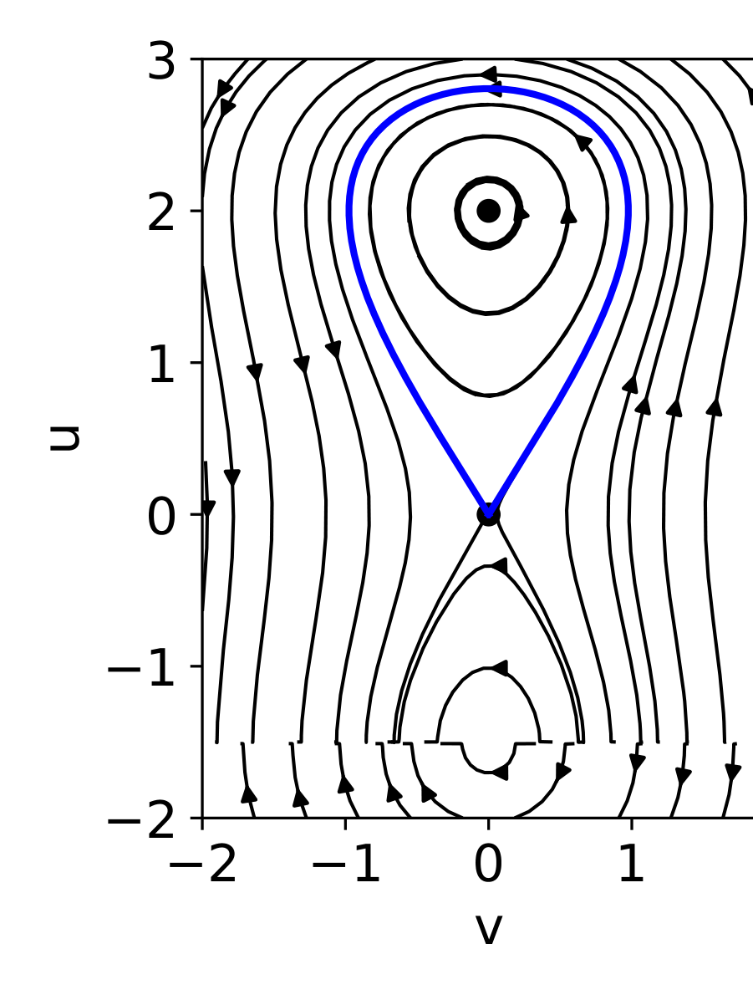</a>
<a href="/papers/biswas2025traveling/"><span class="pub-title">Traveling-wave solutions and structure-preserving numerical methods for a hyperbolic approximation of the Korteweg-de Vries equation</span></a><br>
<span class="pub-authors">Abhijit Biswas, David I Ketcheson, Hendrik Ranocha,  and Jochen Schütz</span>,
<span class="pub-journal">J. Sci. Comput.</span>, 103(3):90 (2025)<br>
<span class="pub-links"><a href="/papers/biswas2025traveling/">More information</a> | <a href="https://doi.org/10.1007/s10915-025-02898-x">Published version</a> | <a href="https://arxiv.org/abs/2412.17117">arXiv version</a> | <a href="https://github.com/abhibsws/2024_kdvh_RR">Reproducibility repository</a></span><div style="clear:both"></div>

</div>

<div class="pub filterable time-integration runge-kutta">
<a href="/papers/izgin2025order/"><span class="pub-title">Order conditions for Runge–Kutta-like methods with solution-dependent coefficients</span></a><br>
<span class="pub-authors">Thomas Izgin, David I Ketcheson,  and Andreas Meister</span>,
<span class="pub-journal">Communications in Applied Mathematics and Computational Science</span>, 20(1):29--66 (2025)<br>
<span class="pub-links"><a href="/papers/izgin2025order/">More information</a> | <a href="https://doi.org/10.2140/camcos.2025.20.29">Published version</a> | <a href="https://arxiv.org/abs/2305.14297">arXiv version</a> | <a href="https://github.com/IzginThomas/NSARK">Reproducibility repository</a></span><div style="clear:both"></div>

</div>

<div class="pub filterable periodic-media hyperbolic">
<a href="/papers/2025_sw1d_homogenization/">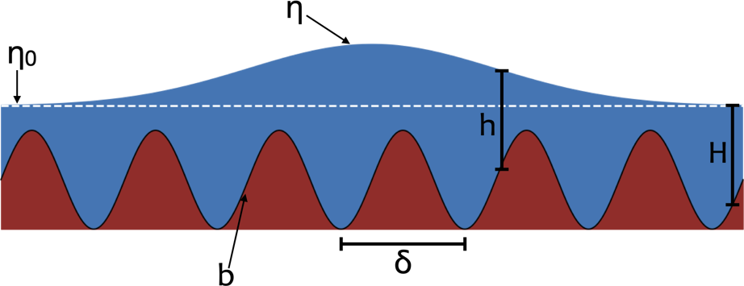</a>
<a href="/papers/2025_sw1d_homogenization/"><span class="pub-title">A multiscale model for weakly nonlinear shallow water waves over periodic bathymetry</span></a><br>
<span class="pub-authors">David I Ketcheson, Lajos Lóczi,  and Giovanni Russo</span>,
<span class="pub-journal">Multiscale Modeling & Simulation</span>, 23(1):397--430 (2025)<br>
<span class="pub-links"><a href="/papers/2025_sw1d_homogenization/">More information</a> | <a href="https://doi.org/10.1137/23M1614869">Published version</a> | <a href="https://arxiv.org/abs/2311.02603">arXiv version</a> | <a href="https://github.com/ketch/shallow_water_bathymetry_effective_medium_RR">Reproducibility repository</a></span><div style="clear:both"></div>

</div>

<div class="pub filterable time-integration runge-kutta">
<a href="/papers/biswas2024algebraic/"><span class="pub-title">Algebraic structure of the weak stage order conditions for Runge–Kutta methods</span></a><br>
<span class="pub-authors">Abhijit Biswas, David Ketcheson, Benjamin Seibold,  and David Shirokoff</span>,
<span class="pub-journal">SIAM Journal on Numerical Analysis</span>, 62(1):48--72 (2024)<br>
<span class="pub-links"><a href="/papers/biswas2024algebraic/">More information</a> | <a href="https://doi.org/10.1137/22M1483943">Published version</a> | <a href="https://arxiv.org/abs/2204.03603">arXiv version</a></span><div style="clear:both"></div>

</div>

<div class="pub filterable time-integration runge-kutta">
<a href="/papers/alamri2024very/">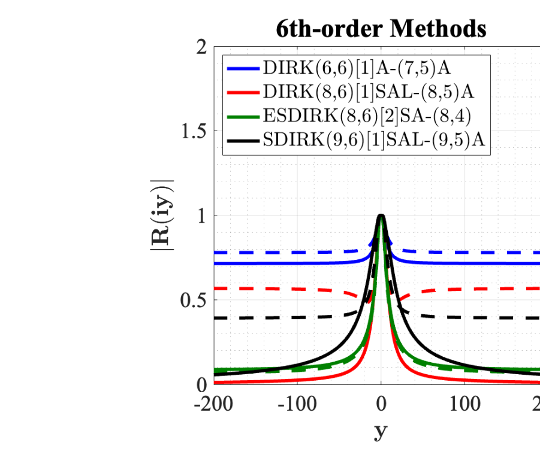</a>
<a href="/papers/alamri2024very/"><span class="pub-title">Very high-order A-stable stiffly accurate diagonally implicit Runge-Kutta methods with error estimators</span></a><br>
<span class="pub-authors">Yousef Alamri  and David I Ketcheson</span>,
<span class="pub-journal">Journal of Scientific Computing</span>, 100(3):84 (2024)<br>
<span class="pub-links"><a href="/papers/alamri2024very/">More information</a> | <a href="https://doi.org/10.1007/s10915-024-02627-w">Published version</a> | <a href="https://arxiv.org/abs/2211.14574">arXiv version</a> | <a href="https://github.com/yousefalamri55/High_Order_DIRK_Methods_Coeffs">Reproducibility repository</a></span><div style="clear:both"></div>

</div>

<div class="pub filterable time-integration runge-kutta">
<a href="/papers/biswas2024accurate/">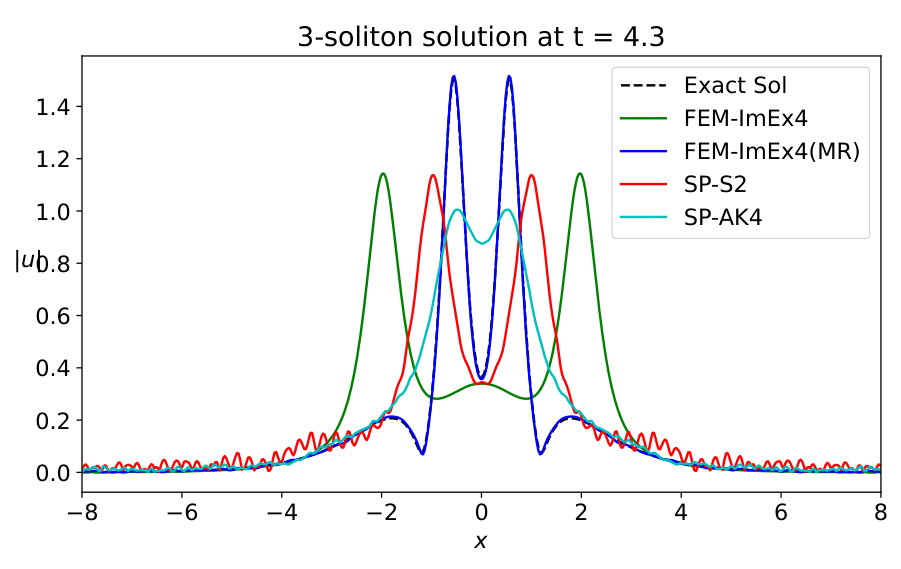</a>
<a href="/papers/biswas2024accurate/"><span class="pub-title">Accurate solution of the nonlinear Schrödinger equation via conservative multiple-relaxation ImEx methods</span></a><br>
<span class="pub-authors">Abhijit Biswas  and David I Ketcheson</span>,
<span class="pub-journal">SIAM Journal on Scientific Computing</span>, 46(6):A3827--A3848 (2024)<br>
<span class="pub-links"><a href="/papers/biswas2024accurate/">More information</a> | <a href="https://doi.org/10.1137/23M1598118">Published version</a> | <a href="https://arxiv.org/abs/2309.02324">arXiv version</a> | <a href="https://github.com/abhibsws/Multiple_Relaxation_NLS">Reproducibility repository</a></span><div style="clear:both"></div>

</div>

<div class="pub filterable time-integration runge-kutta">
<a href="/papers/ketcheson2023computing/">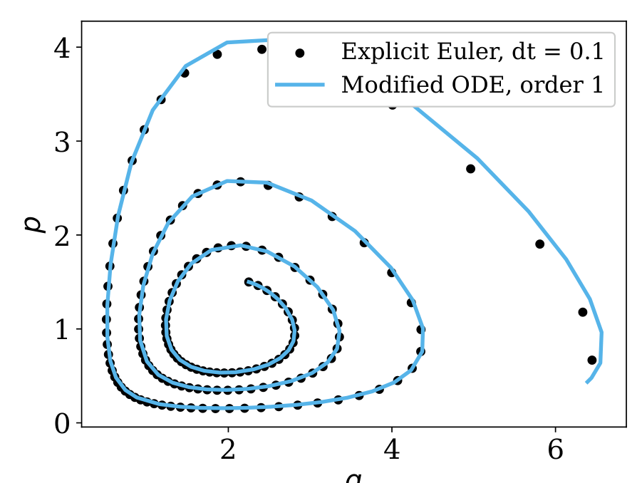</a>
<a href="/papers/ketcheson2023computing/"><span class="pub-title">Computing with B-series</span></a><br>
<span class="pub-authors">David I Ketcheson  and Hendrik Ranocha</span>,
<span class="pub-journal">ACM Transactions on Mathematical Software</span>, 49(2):1--23 (2023)<br>
<span class="pub-links"><a href="/papers/ketcheson2023computing/">More information</a> | <a href="https://doi.org/10.1145/3573384">Published version</a> | <a href="https://arxiv.org/abs/2111.11680">arXiv version</a> | <a href="https://github.com/ketch/bseries-package-notebooks">Reproducibility repository</a></span><div style="clear:both"></div>

</div>

<div class="pub filterable time-integration runge-kutta">
<a href="/papers/biswas2023design/">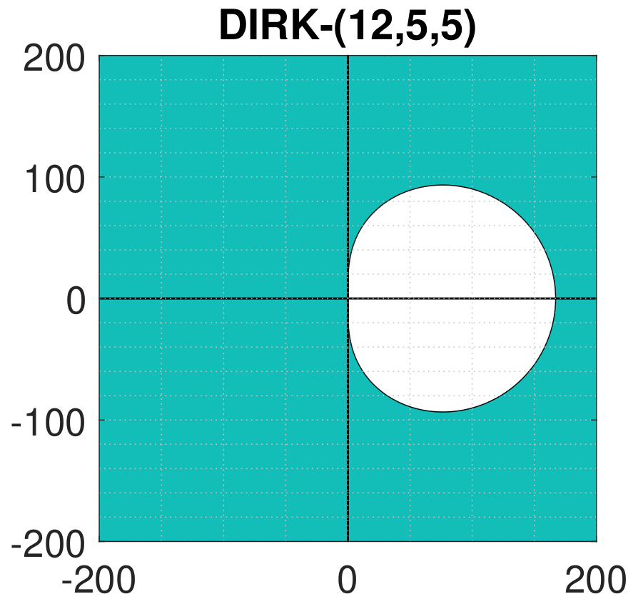</a>
<a href="/papers/biswas2023design/"><span class="pub-title">Design of DIRK schemes with high weak stage order</span></a><br>
<span class="pub-authors">Abhijit Biswas, David I Ketcheson, Benjamin Seibold,  and David Shirokoff</span>,
<span class="pub-journal">Communications in Applied Mathematics and Computational Science</span>, 18(1):1--28 (2023)<br>
<span class="pub-links"><a href="/papers/biswas2023design/">More information</a> | <a href="https://doi.org/10.2140/camcos.2023.18.1">Published version</a> | <a href="https://arxiv.org/abs/2204.11264">arXiv version</a></span><div style="clear:both"></div>

</div>

<div class="pub filterable time-integration runge-kutta">
<a href="/papers/biswas2023multiple/">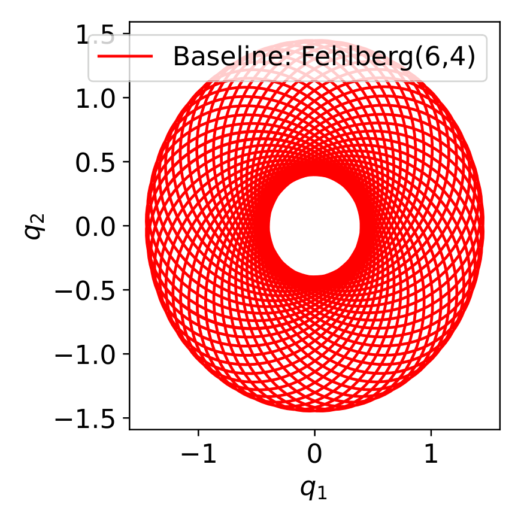</a>
<a href="/papers/biswas2023multiple/"><span class="pub-title">Multiple-relaxation Runge-Kutta methods for conservative dynamical systems</span></a><br>
<span class="pub-authors">Abhijit Biswas  and David I Ketcheson</span>,
<span class="pub-journal">Journal of Scientific Computing</span>, 97(1):4 (2023)<br>
<span class="pub-links"><a href="/papers/biswas2023multiple/">More information</a> | <a href="https://doi.org/10.1007/s10915-023-02312-4">Published version</a> | <a href="https://arxiv.org/abs/2302.05235">arXiv version</a> | <a href="https://github.com/abhibsws/Multiple_Relaxation_RK_Methods">Reproducibility repository</a></span><div style="clear:both"></div>

</div>

<div class="pub filterable hyperbolic">
<a href="/papers/munoz2023comparative/"><span class="pub-title">A comparative study of iterative Riemann solvers for the shallow water and Euler equations</span></a><br>
<span class="pub-authors">Carlos Muñoz Moncayo, Manuel Luna,  and David I Ketcheson</span>,
<span class="pub-journal">Communications in Applied Mathematics and Computational Science</span>, 18(1):107--134 (2023)<br>
<span class="pub-links"><a href="/papers/munoz2023comparative/">More information</a> | <a href="https://doi.org/10.2140/camcos.2023.18.107">Published version</a> | <a href="https://arxiv.org/abs/2209.12235">arXiv version</a> | <a href="https://doi.org/10.5281/zenodo.8335057">Reproducibility repository</a></span><div style="clear:both"></div>

</div>

<div class="pub filterable hyperbolic runge-kutta ssp">
<a href="/papers/kuzmin2020bound/">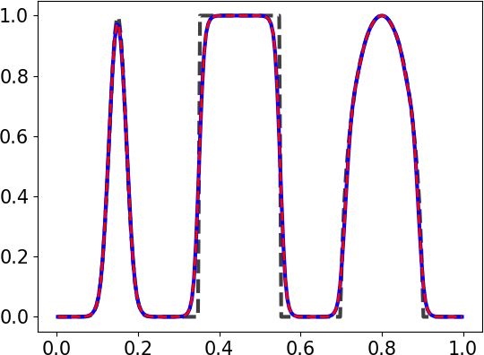</a>
<a href="/papers/kuzmin2020bound/"><span class="pub-title">Bound-preserving convex limiting for high-order Runge-Kutta time discretizations of hyperbolic conservation laws</span></a><br>
<span class="pub-authors">Dmitri Kuzmin, Manuel Luna, David I Ketcheson,  and Johanna Grüll</span>,
<span class="pub-journal">Journal of Scientific Computing</span>, 91(21) (2022)<br>
<span class="pub-links"><a href="/papers/kuzmin2020bound/">More information</a> | <a href="https://doi.org/10.1007/s10915-022-01784-0">Published version</a> | <a href="https://arxiv.org/abs/2009.01133">arXiv version</a></span><div style="clear:both"></div>

</div>

<div class="pub filterable time-integration runge-kutta">
<a href="/papers/quezada2021maximum/">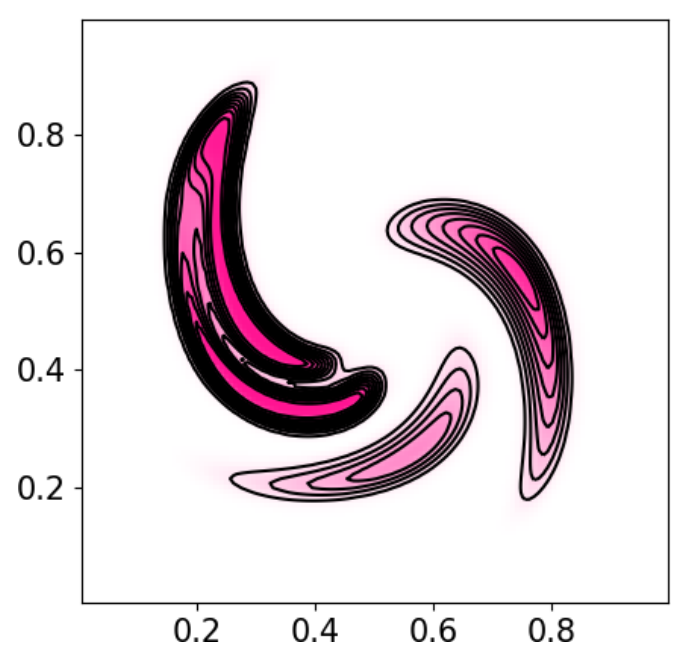</a>
<a href="/papers/quezada2021maximum/"><span class="pub-title">Maximum principle preserving space and time flux limiting for Diagonally Implicit Runge-Kutta discretizations of scalar convection-diffusion equations</span></a><br>
<span class="pub-authors">Manuel Quezada Luna  and David I. Ketcheson</span>,
<span class="pub-journal">Journal of Scientific Computing</span>, 92(102) (2022)<br>
<span class="pub-links"><a href="/papers/quezada2021maximum/">More information</a> | <a href="https://doi.org/10.1007/s10915-022-01922-8">Published version</a> | <a href="https://arxiv.org/abs/2109.08272">arXiv version</a> | <a href="https://github.com/manuel-quezada/BP_Lim_for_imp_RK_Methods">Reproducibility repository</a></span><div style="clear:both"></div>

</div>

<div class="pub filterable hyperbolic water-waves riemann-solvers">
<a href="/papers/ketcheson2022numerical/">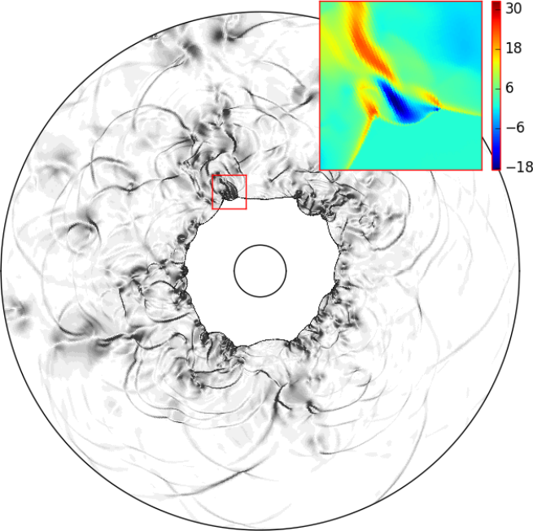</a>
<a href="/papers/ketcheson2022numerical/"><span class="pub-title">Numerical simulation and entropy dissipative cure of the carbuncle instability for the shallow water circular hydraulic jump</span></a><br>
<span class="pub-authors">David I. Ketcheson  and Manuel Quezada Luna</span>,
<span class="pub-journal">International Journal for Numerical Methods in Fluids</span>, 94(6):655--677 (2022)<br>
<span class="pub-links"><a href="/papers/ketcheson2022numerical/">More information</a> | <a href="https://doi.org/10.1002/fld.5070">Published version</a> | <a href="https://arxiv.org/abs/2103.09664">arXiv version</a></span><div style="clear:both"></div>

</div>

<div class="pub filterable runge-kutta time-integration">
<a href="/papers/ranocha2021optimized/">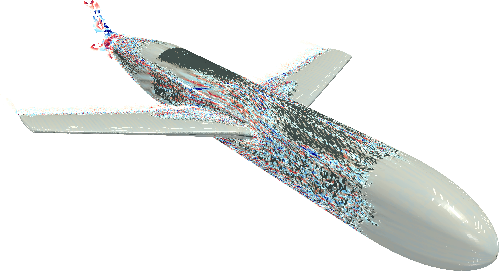</a>
<a href="/papers/ranocha2021optimized/"><span class="pub-title">Optimized Runge-Kutta Methods with Automatic Step Size Control for Compressible Computational Fluid Dynamics</span></a><br>
<span class="pub-authors">Hendrik Ranocha, Lisandro Dalcin, Matteo Parsani,  and David I. Ketcheson</span>,
<span class="pub-journal">Communications on Applied Mathematics and Computation</span>, 4(4):1191--1228 (2022)<br>
<span class="pub-links"><a href="/papers/ranocha2021optimized/">More information</a> | <a href="https://doi.org/10.1007/s42967-021-00159-w">Published version</a> | <a href="https://arxiv.org/abs/2104.06836">arXiv version</a> | <a href="https://github.com/ranocha/Optimized-RK-CFD">Reproducibility repository</a></span><div style="clear:both"></div>

</div>

<div class="pub filterable epidemiology">
<a href="/papers/Duarte2021.03.27.437300/">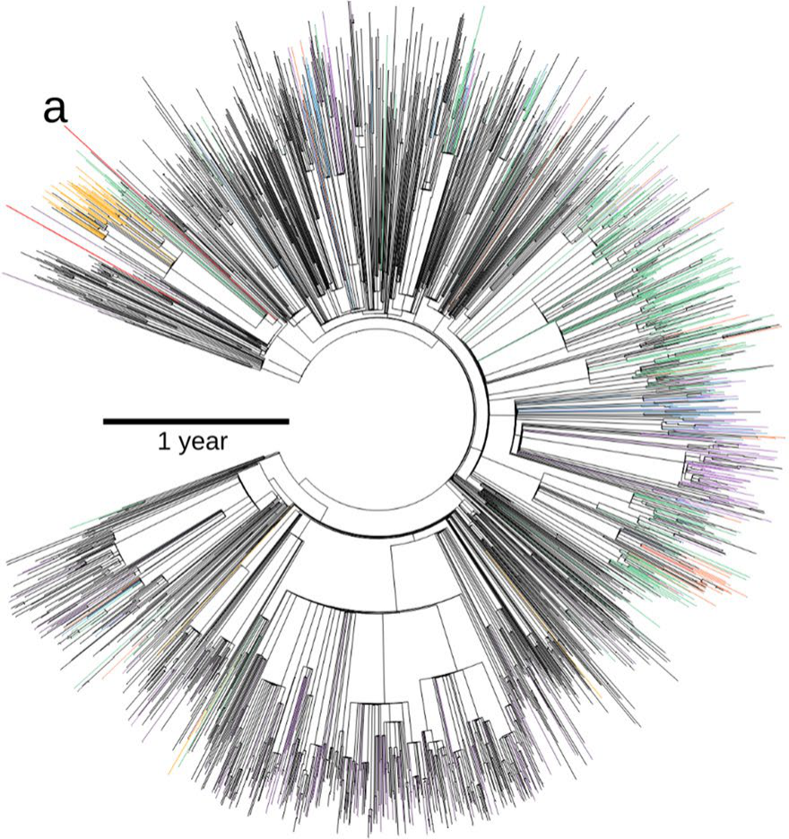</a>
<a href="/papers/Duarte2021.03.27.437300/"><span class="pub-title">Rapid Evolution of SARS-CoV-2 Challenges Human Defenses</span></a><br>
<span class="pub-authors">Carlos M. Duarte, David I. Ketcheson, Víctor M. Eguíluz, Susana Agustí, Juan Fernández-Gracia, Tahira Jamil, Elisa Laiolo, Takashi Gojobori,  and Intikhab Alam</span>,
<span class="pub-journal">Scientific Reports</span>, 12(6457) (2022)<br>
<span class="pub-links"><a href="/papers/Duarte2021.03.27.437300/">More information</a> | <a href="https://doi.org/10.1038/s41598-022-10097-z">Published version</a></span><div style="clear:both"></div>

</div>

<div class="pub filterable time-integration dispersive-waves">
<a href="/papers/2020_broad/">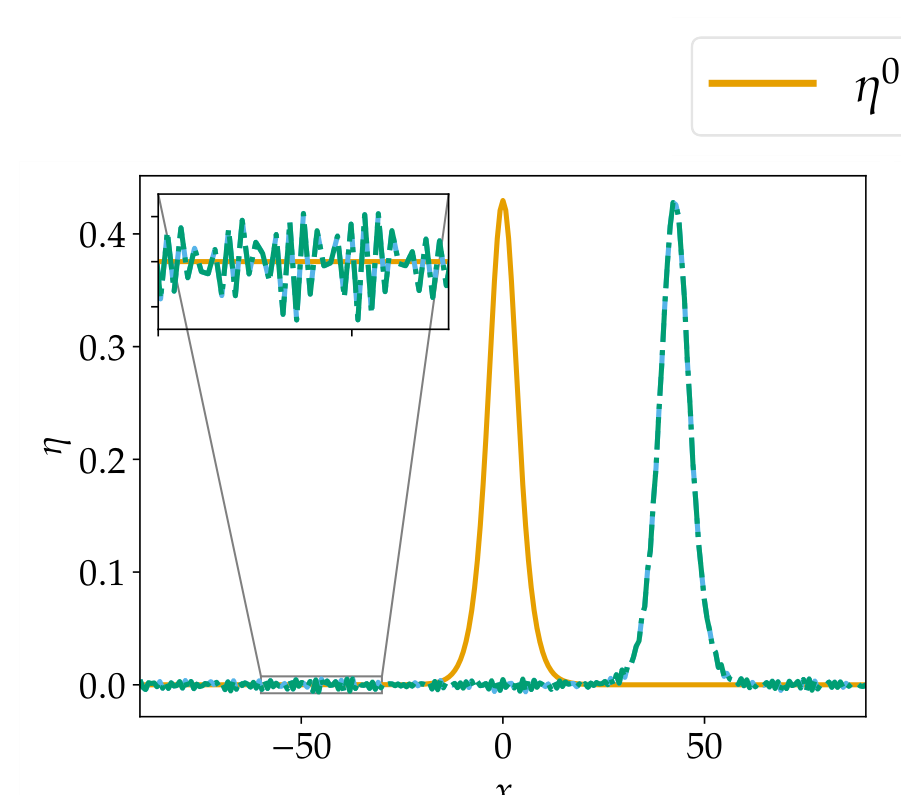</a>
<a href="/papers/2020_broad/"><span class="pub-title">A broad class of conservative numerical methods for dispersive wave equations</span></a><br>
<span class="pub-authors">Hendrik Ranocha, Dimitrios Mitsotakis,  and David I Ketcheson</span>,
<span class="pub-journal">Communications in Computational Physics</span>, 29(4):979--1029 (2021)<br>
<span class="pub-links"><a href="/papers/2020_broad/">More information</a> | <a href="https://doi.org/10.4208/CICP.OA-2020-0119">Published version</a> | <a href="https://arxiv.org/abs/2006.14802">arXiv version</a> | <a href="https://github.com/ranocha/Dispersive-wave-schemes-notebooks">Reproducibility repository</a></span><div style="clear:both"></div>

</div>

<div class="pub filterable time-integration dispersive-waves">
<a href="/papers/2020_conservative/">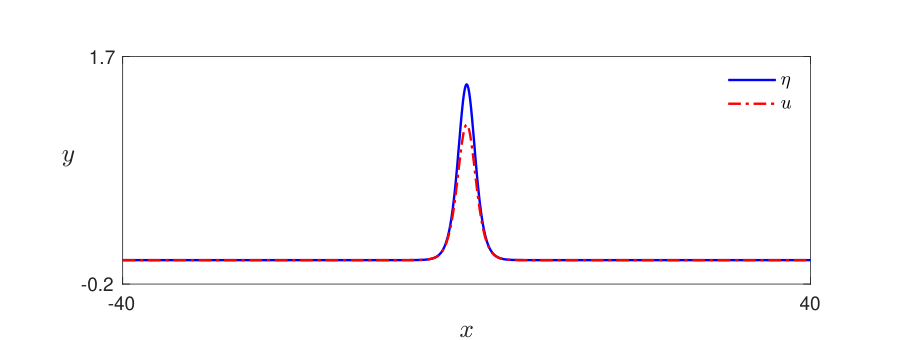</a>
<a href="/papers/2020_conservative/"><span class="pub-title">A conservative fully-discrete numerical method for the regularised shallow water wave equations</span></a><br>
<span class="pub-authors">Dimitrios Mitsotakis, Hendrik Ranocha, David I Ketcheson,  and Endre Süli</span>,
<span class="pub-journal">SIAM Journal on Scientific Computing</span>, 43(2):B508--B537 (2021)<br>
<span class="pub-links"><a href="/papers/2020_conservative/">More information</a> | <a href="https://doi.org/10.1137/20M1364606">Published version</a> | <a href="https://arxiv.org/abs/2009.09641">arXiv version</a></span><div style="clear:both"></div>

</div>

<div class="pub filterable epidemiology">
<a href="/papers/avram2021review/">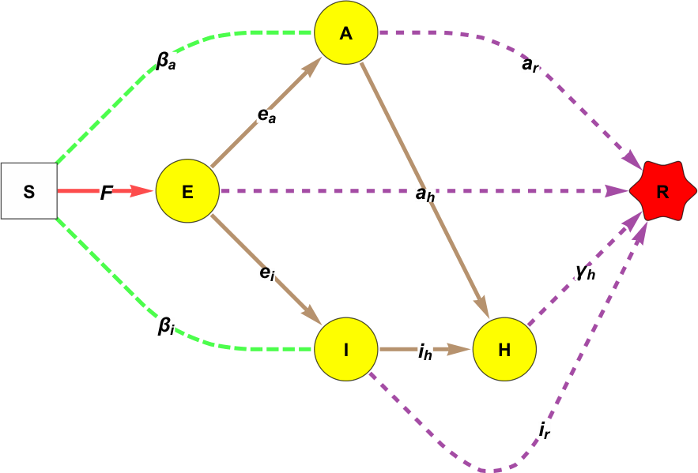</a>
<a href="/papers/avram2021review/"><span class="pub-title">A review of matrix SIR Arino epidemic models</span></a><br>
<span class="pub-authors">Florin Avram, Rim Adenane,  and David I. Ketcheson</span>,
<span class="pub-journal">Mathematics</span>, 9(13):1513 (2021)<br>
<span class="pub-links"><a href="/papers/avram2021review/">More information</a> | <a href="https://doi.org/10.3390/math9131513">Published version</a> | <a href="https://arxiv.org/abs/2106.00384">arXiv version</a></span><div style="clear:both"></div>

</div>

<div class="pub filterable dispersive-waves time-integration">
<a href="/papers/ranocha2021rate/">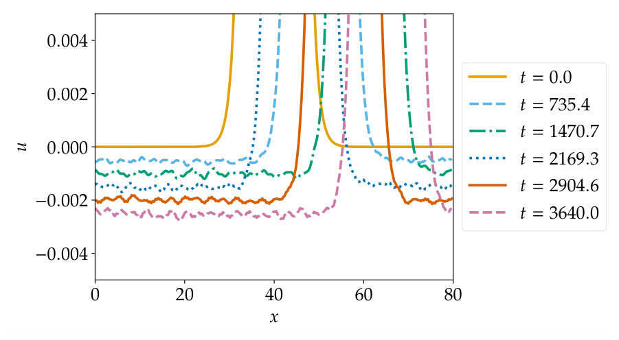</a>
<a href="/papers/ranocha2021rate/"><span class="pub-title">On the Rate of Error Growth in Time for Numerical Solutions of Nonlinear Dispersive Wave Equations</span></a><br>
<span class="pub-authors">Hendrik Ranocha, Manuel Quezada Luna,  and David I. Ketcheson</span>,
<span class="pub-journal">Partial Differential Equations and Applications</span>, 2(6):1--26 Accepted. (2021)<br>
<span class="pub-links"><a href="/papers/ranocha2021rate/">More information</a> | <a href="https://doi.org/10.1007/s42985-021-00126-3">Published version</a> | <a href="https://arxiv.org/abs/2102.07376">arXiv version</a> | <a href="https://github.com/ranocha/Dispersive-wave-error-growth-notebooks">Reproducibility repository</a></span><div style="clear:both"></div>

</div>

<div class="pub filterable epidemiology">
<a href="/papers/ketcheson2021optimal/">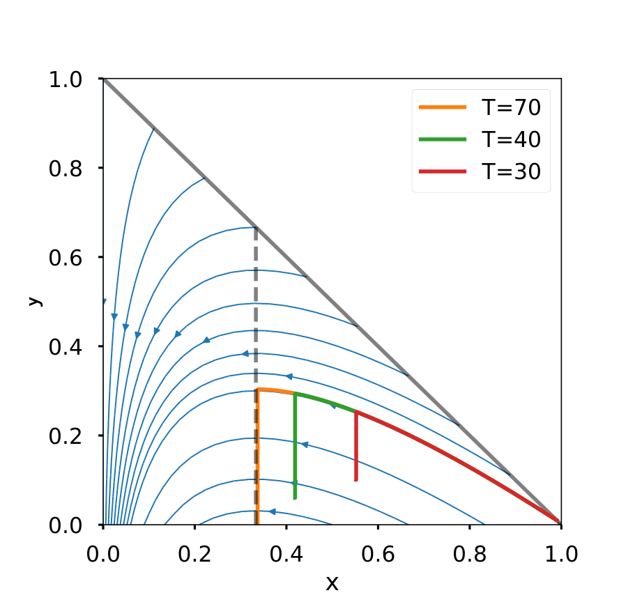</a>
<a href="/papers/ketcheson2021optimal/"><span class="pub-title">Optimal control of an SIR epidemic through finite-time non-pharmaceutical intervention</span></a><br>
<span class="pub-authors">David I Ketcheson</span>,
<span class="pub-journal">Journal of Mathematical Biology</span>, 83(1):1--21 (2021)<br>
<span class="pub-links"><a href="/papers/ketcheson2021optimal/">More information</a> | <a href="https://doi.org/10.1007/s00285-021-01628-9">Published version</a> | <a href="https://arxiv.org/abs/2004.08848">arXiv version</a> | <a href="https://github.com/ketch/SIR-control-code">Reproducibility repository</a></span><div style="clear:both"></div>

</div>

<div class="pub filterable time-integration runge-kutta">
<a href="/papers/nusslein2021positivity/">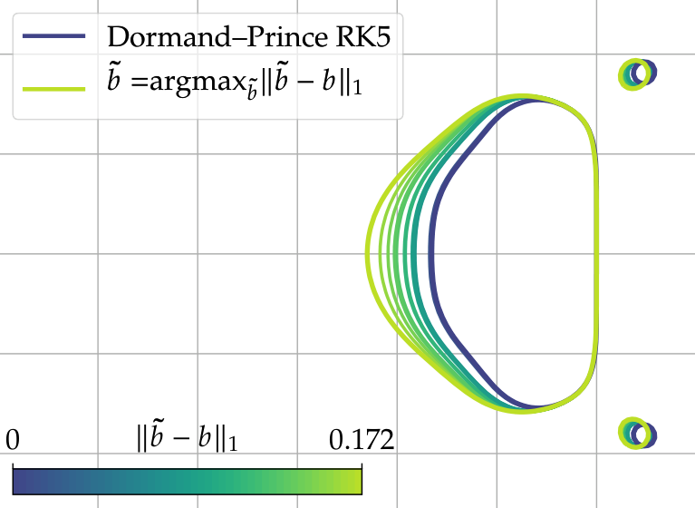</a>
<a href="/papers/nusslein2021positivity/"><span class="pub-title">Positivity-Preserving Adaptive Runge-Kutta Methods</span></a><br>
<span class="pub-authors">Stephan Nüßlein, Hendrik Ranocha,  and David I Ketcheson</span>,
<span class="pub-journal">Communications in Applied Mathematics and Computational Science</span>, 16(2):155-179 (2021)<br>
<span class="pub-links"><a href="/papers/nusslein2021positivity/">More information</a> | <a href="https://doi.org/10.2140/camcos.2021.16.155">Published version</a> | <a href="https://arxiv.org/abs/2005.06268">arXiv version</a> | <a href="https://github.com/ketch/Positive_RK_Reproducibility">Reproducibility repository</a></span><div style="clear:both"></div>

</div>

<div class="pub filterable periodic-media hyperbolic">
<a href="/papers/2021_solitary/">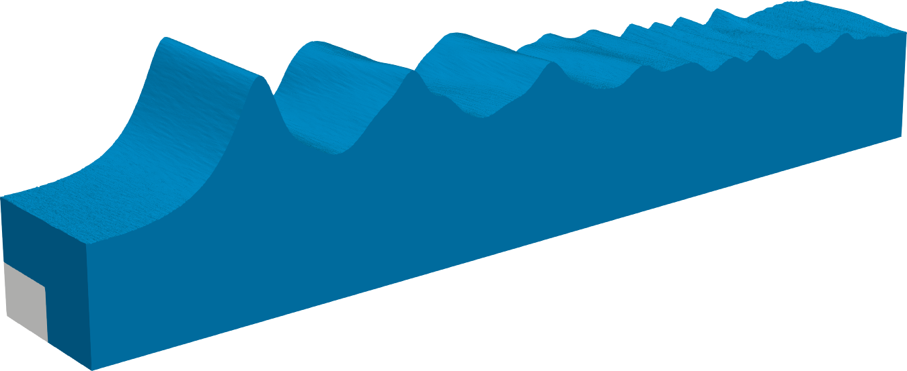</a>
<a href="/papers/2021_solitary/"><span class="pub-title">Solitary water waves created by variations in bathymetry</span></a><br>
<span class="pub-authors">Manuel Quezada de Luna  and David I Ketcheson</span>,
<span class="pub-journal">Journal of Fluid Mechanics</span>, 917 (2021)<br>
<span class="pub-links"><a href="/papers/2021_solitary/">More information</a> | <a href="https://doi.org/10.1017/jfm.2021.267">Published version</a> | <a href="https://arxiv.org/abs/1907.07094">arXiv version</a> | <a href="https://github.com/manuel-quezada/water_wave_diffractons_RR">Reproducibility repository</a></span><div style="clear:both"></div>

</div>

<div class="pub filterable epidemiology">
<a href="/papers/2020_assessing/"><span class="pub-title">Assessing the age-and gender-dependence of the severity and case fatality rates of COVID-19 disease in Spain</span></a><br>
<span class="pub-authors">Paula Moraga, David I Ketcheson, Hernando C Ombao,  and Carlos M Duarte</span>,
<span class="pub-journal">Wellcome Open Research</span>, 5(117):117 (2020)<br>
<span class="pub-links"><a href="/papers/2020_assessing/">More information</a> | <a href="https://doi.org/10.12688/wellcomeopenres.15996.1">Published version</a></span><div style="clear:both"></div>

</div>

<div class="pub filterable periodic-media hyperbolic">
<a href="/papers/2019_periodic/">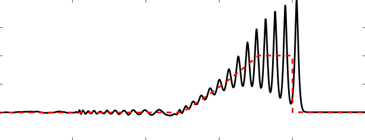</a>
<a href="/papers/2019_periodic/"><span class="pub-title">Effective Rankine-Hugoniot conditions for shock waves in periodic media</span></a><br>
<span class="pub-authors">David I Ketcheson  and Manuel Luna</span>,
<span class="pub-journal">Communications in Mathematical Sciences</span>, 18(4):1023--1040 (2020)<br>
<span class="pub-links"><a href="/papers/2019_periodic/">More information</a> | <a href="https://doi.org/10.4310/CMS.2020.V18.N4.A6">Published version</a> | <a href="https://arxiv.org/abs/1909.04937">arXiv version</a></span><div style="clear:both"></div>

</div>

<div class="pub filterable time-integration runge-kutta">
<a href="/papers/2019_energystability/">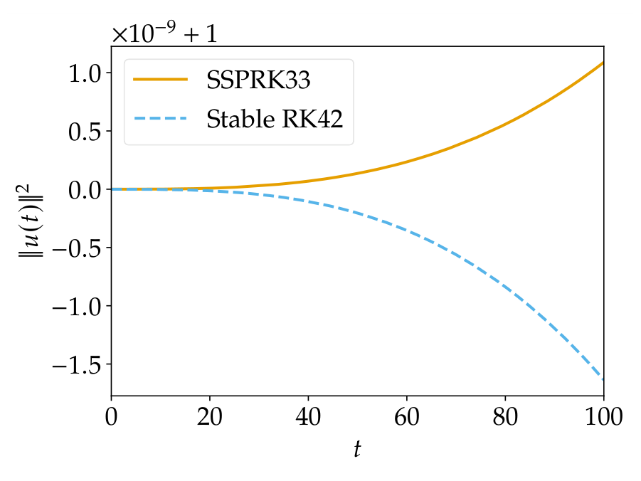</a>
<a href="/papers/2019_energystability/"><span class="pub-title">Energy Stability of Explicit Runge-Kutta Methods for Non-autonomous or Nonlinear Problems</span></a><br>
<span class="pub-authors">Hendrik Ranocha  and David I Ketcheson</span>,
<span class="pub-journal">SIAM Journal On Numerical Analysis</span>, 58(6):3382--3405 (2020)<br>
<span class="pub-links"><a href="/papers/2019_energystability/">More information</a> | <a href="https://doi.org/10.1137/19M1290346">Published version</a> | <a href="https://arxiv.org/abs/1909.13215">arXiv version</a> | <a href="https://github.com/ranocha/EnergyStabilityExplicitRungeKuttaNonlinearNonautonomous">Reproducibility repository</a></span><div style="clear:both"></div>

</div>

<div class="pub filterable time-integration">
<a href="/papers/2020_relaxation/">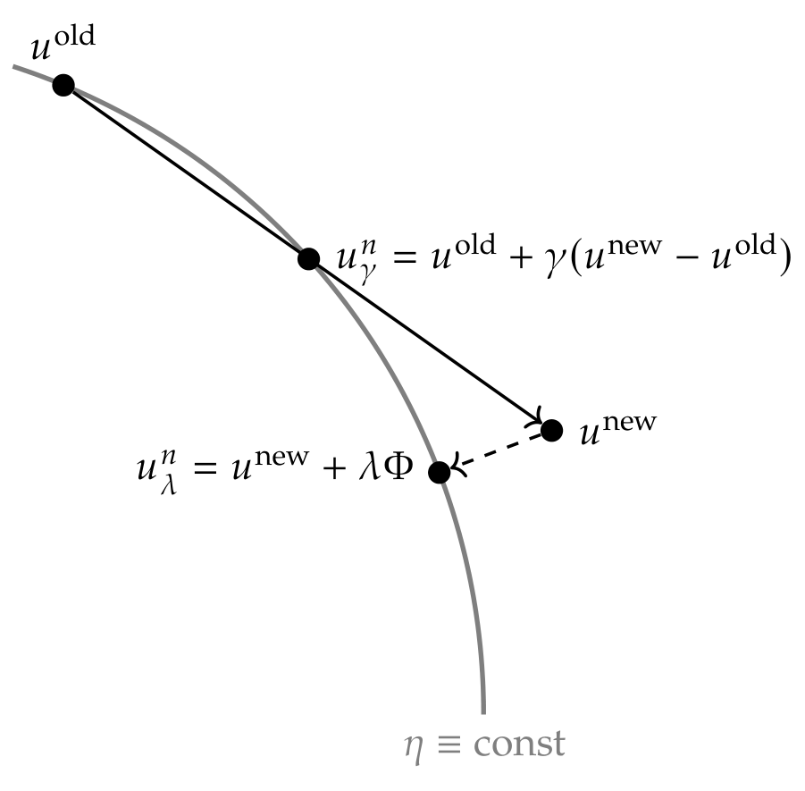</a>
<a href="/papers/2020_relaxation/"><span class="pub-title">General Relaxation Methods for Initial-Value Problems with Application to Multistep Schemes</span></a><br>
<span class="pub-authors">Hendrik Ranocha, Lajos Lóczi,  and David I Ketcheson</span>,
<span class="pub-journal">Numerische Mathematik</span>, 146 (2020)<br>
<span class="pub-links"><a href="/papers/2020_relaxation/">More information</a> | <a href="https://doi.org/10.1007/s00211-020-01158-4">Published version</a> | <a href="https://arxiv.org/abs/2003.03012">arXiv version</a> | <a href="https://github.com/ranocha/Relaxation-LMM-notebooks">Reproducibility repository</a></span><div style="clear:both"></div>

</div>

<div class="pub filterable time-integration runge-kutta">
<a href="/papers/2019_DNStime/">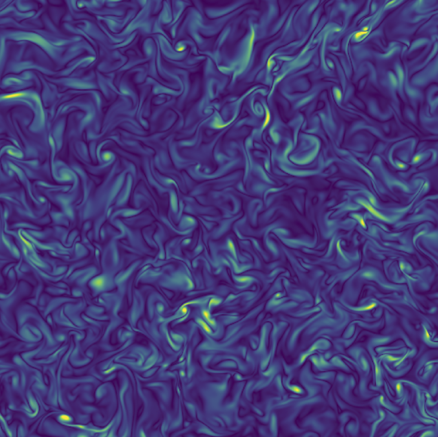</a>
<a href="/papers/2019_DNStime/"><span class="pub-title">More efficient time integration for Fourier pseudo-spectral DNS of incompressible turbulence</span></a><br>
<span class="pub-authors">David I Ketcheson, Mikael Mortensen, Matteo Parsani,  and Nathanael Schilling</span>,
<span class="pub-journal">International Journal for Numerical Methods in Fluids</span>, 92(2):79--93 (2020)<br>
<span class="pub-links"><a href="/papers/2019_DNStime/">More information</a> | <a href="https://doi.org/10.1002/fld.4773">Published version</a> | <a href="https://arxiv.org/abs/1810.10197">arXiv version</a></span><div style="clear:both"></div>

</div>

<div class="pub filterable time-integration runge-kutta">
<a href="/papers/2020_nodepy/"><span class="pub-title">NodePy: A package for the analysis of numerical ODE solvers</span></a><br>
<span class="pub-authors">David I. Ketcheson, Hendrik Ranocha, Matteo Parsani, Umair Bin Waheed,  and Yiannis Hadjimichael</span>,
<span class="pub-journal">Journal of Open Source Software</span>, 5(55):2515 (2020)<br>
<span class="pub-links"><a href="/papers/2020_nodepy/">More information</a> | <a href="https://doi.org/10.21105/joss.02515">Published version</a></span><div style="clear:both"></div>

</div>

<div class="pub filterable time-integration runge-kutta">
<a href="/papers/ranocha2020relaxation/">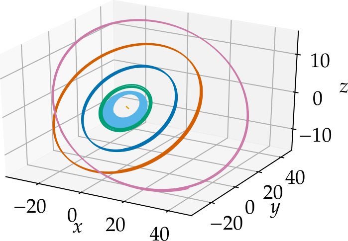</a>
<a href="/papers/ranocha2020relaxation/"><span class="pub-title">Relaxation Runge-Kutta Methods for Hamiltonian Problems</span></a><br>
<span class="pub-authors">Hendrik Ranocha  and David I Ketcheson</span>,
<span class="pub-journal">Journal of Scientific Computing</span>, 84 (2020)<br>
<span class="pub-links"><a href="/papers/ranocha2020relaxation/">More information</a> | <a href="https://doi.org/10.1007/s10915-020-01277-y">Published version</a> | <a href="https://arxiv.org/abs/2001.04826">arXiv version</a> | <a href="https://github.com/ranocha/Hamiltonian-RRK-notebooks">Reproducibility repository</a></span><div style="clear:both"></div>

</div>

<div class="pub filterable runge-kutta time-integration hyperbolic">
<a href="/papers/2019_entropyRRK/">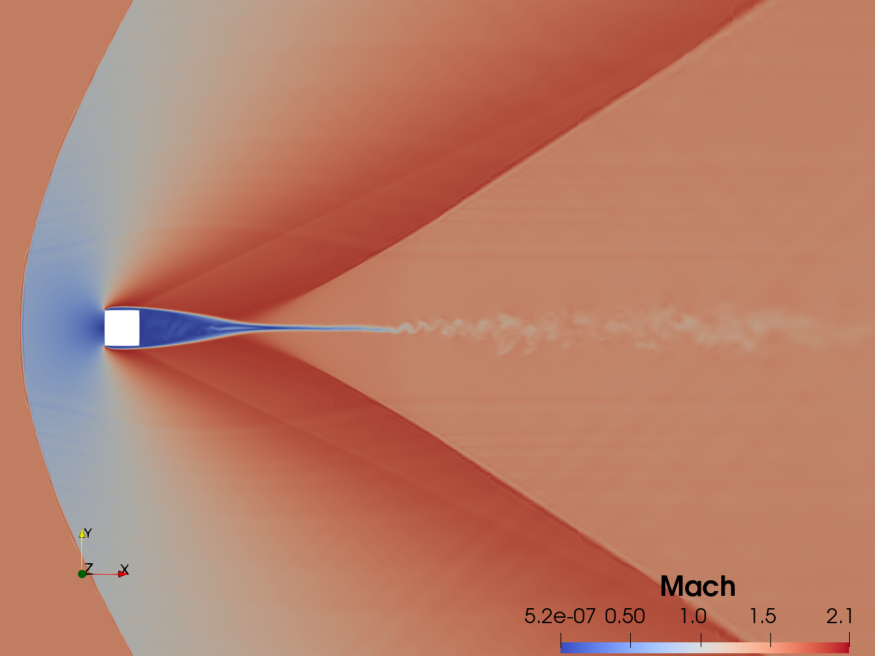</a>
<a href="/papers/2019_entropyRRK/"><span class="pub-title">Relaxation Runge-Kutta Methods: Fully-Discrete Explicit Entropy-Stable Schemes for the Euler and Navier-Stokes Equations</span></a><br>
<span class="pub-authors">Hendrik Ranocha, Mohammed Sayyari, Lisandro Dalcin, Matteo Parsani,  and David I Ketcheson</span>,
<span class="pub-journal">SIAM Journal on Scientific Computing</span>, 42(2):A612--A638 (2020)<br>
<span class="pub-links"><a href="/papers/2019_entropyRRK/">More information</a> | <a href="https://doi.org/10.1137/19M1263480">Published version</a> | <a href="https://arxiv.org/abs/1905.09129">arXiv version</a> | <a href="https://github.com/ranocha/ConvexRelaxationRungeKutta">Reproducibility repository</a></span><div style="clear:both"></div>

</div>

<div class="pub filterable time-integration runge-kutta">
<a href="/papers/2020_RK-opt/"><span class="pub-title">RK-Opt: A package for the design of numerical ODE solvers</span></a><br>
<span class="pub-authors">David I. Ketcheson, Matteo Parsani, Zachary J. Grant, Aron J. Ahmadia,  and Hendrik Ranocha</span>,
<span class="pub-journal">Journal of Open Source Software</span>, 5(54):2514 (2020)<br>
<span class="pub-links"><a href="/papers/2020_RK-opt/">More information</a> | <a href="https://doi.org/10.21105/joss.02514">Published version</a></span><div style="clear:both"></div>

</div>

<div class="pub filterable ">
<a href="/papers/2019_shoaling/">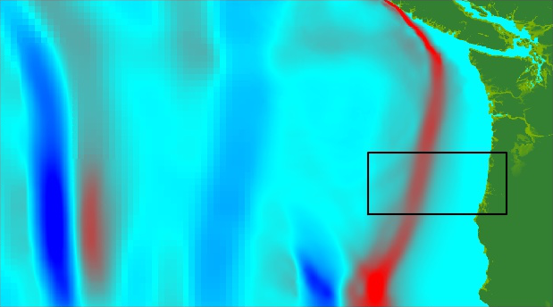</a>
<a href="/papers/2019_shoaling/"><span class="pub-title">Shoaling on Steep Continental Slopes: Relating Transmission and Reflection Coefficients to Green's Law</span></a><br>
<span class="pub-authors">Jithin George, David I. Ketcheson,  and Randall J. LeVeque</span>,
<span class="pub-journal">Pure and Applied Geophysics</span> (2019)<br>
<span class="pub-links"><a href="/papers/2019_shoaling/">More information</a> | <a href="https://doi.org/10.1007/s00024-019-02316-y">Published version</a> | <a href="https://arxiv.org/abs/1901.04148">arXiv version</a> | <a href="https://github.com/rjleveque/shoaling_paper_figures">Reproducibility repository</a></span><div style="clear:both"></div>

</div>

<div class="pub filterable hyperbolic">
<a href="/papers/2019_characteristics/">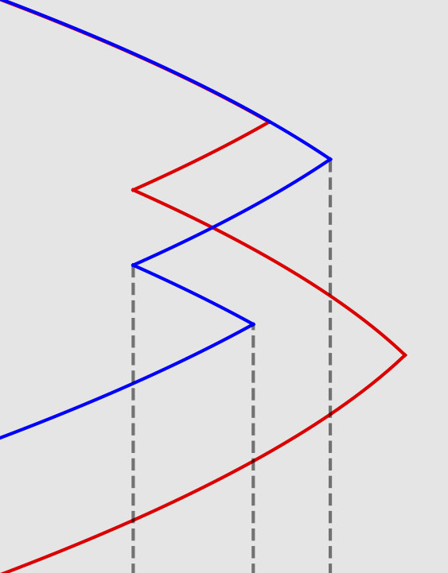</a>
<a href="/papers/2019_characteristics/"><span class="pub-title">A Path-integral method for solution of the wave equation with continuously-varying coefficients</span></a><br>
<span class="pub-authors">Jithin D George, David I Ketcheson,  and Randall J LeVeque</span>,
<span class="pub-journal">SIAM Journal on Applied Mathematics</span>, 79(6):2615--2638 (2019)<br>
<span class="pub-links"><a href="/papers/2019_characteristics/">More information</a> | <a href="https://doi.org/10.1137/19M1238630">Published version</a> | <a href="https://arxiv.org/abs/1901.04158">arXiv version</a> | <a href="https://github.com/ketch/characteristics_rr">Reproducibility repository</a></span><div style="clear:both"></div>

</div>

<div class="pub filterable runge-kutta time-integration hyperbolic">
<a href="/papers/2019_energyRRK/">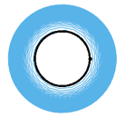</a>
<a href="/papers/2019_energyRRK/"><span class="pub-title">Relaxation Runge-Kutta Methods: Conservation and stability for Inner-Product Norms</span></a><br>
<span class="pub-authors">David I. Ketcheson</span>,
<span class="pub-journal">SIAM Journal on Numerical Analysis</span>, 57(6):2850-2870 (2019)<br>
<span class="pub-links"><a href="/papers/2019_energyRRK/">More information</a> | <a href="https://doi.org/10.1137/19M1263662">Published version</a> | <a href="https://arxiv.org/abs/1905.09847">arXiv version</a> | <a href="https://github.com/ketch/RRK_rr">Reproducibility repository</a></span><div style="clear:both"></div>

</div>

<div class="pub filterable time-integration hyperbolic">
<a href="/papers/2018_staggered/">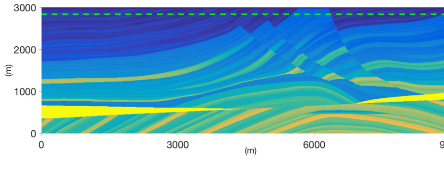</a>
<a href="/papers/2018_staggered/"><span class="pub-title">On long-time instabilities in staggered finite difference simulations of the seismic acoustic wave equations on discontinuous grids</span></a><br>
<span class="pub-authors">Longfei Gao, David I. Ketcheson,  and David E. Keyes</span>,
<span class="pub-journal">Geophysical Journal International</span>, 212(2):1098--1110 (2018)<br>
<span class="pub-links"><a href="/papers/2018_staggered/">More information</a> | <a href="https://doi.org/10.1093/gji/ggx470">Published version</a></span><div style="clear:both"></div>

</div>

<div class="pub filterable time-integration runge-kutta downwinding ssp">
<a href="/papers/2018_perturbations/">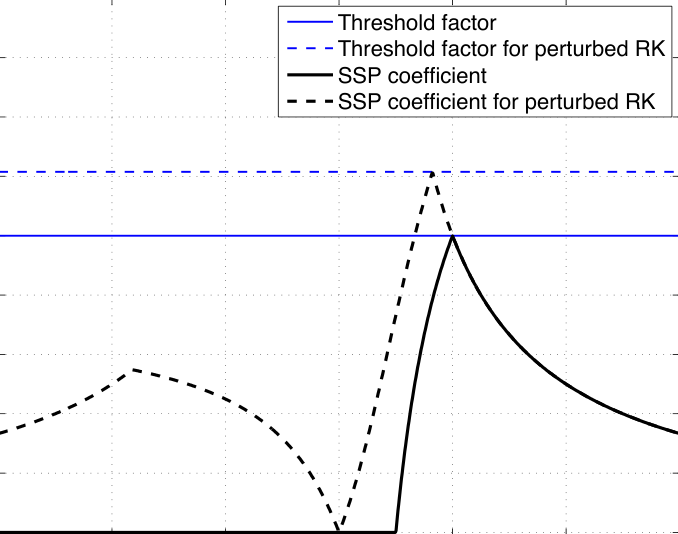</a>
<a href="/papers/2018_perturbations/"><span class="pub-title">Optimal Monotonicity-Preserving Perturbations of a Given Runge–Kutta Method</span></a><br>
<span class="pub-authors">Inmaculada Higueras, David I. Ketcheson,  and Tihamér A. Kocsis</span>,
<span class="pub-journal">Journal of Scientific Computing</span>, 76(3):1337--1369 (2018)<br>
<span class="pub-links"><a href="/papers/2018_perturbations/">More information</a> | <a href="https://doi.org/10.1007/s10915-018-0664-3">Published version</a> | <a href="https://arxiv.org/abs/1505.04024">arXiv version</a> | <a href="https://doi.org/10.5281/zenodo.1146916">Reproducibility repository</a></span><div style="clear:both"></div>

</div>

<div class="pub filterable ssp time-integration runge-kutta hyperbolic">
<a href="/papers/2018_positivity/">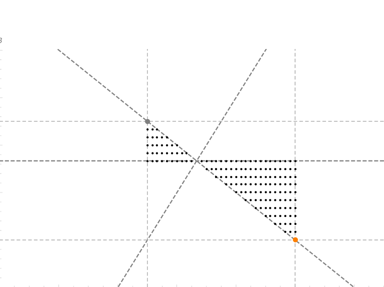</a>
<a href="/papers/2018_positivity/"><span class="pub-title">Positivity for convective semi-discretizations</span></a><br>
<span class="pub-authors">Imre Fekete, David I Ketcheson,  and Lajos Lóczi</span>,
<span class="pub-journal">Journal of Scientific Computing</span>, 74(1):244--266 (2018)<br>
<span class="pub-links"><a href="/papers/2018_positivity/">More information</a> | <a href="https://doi.org/10.1007/s10915-017-0432-9">Published version</a> | <a href="https://arxiv.org/abs/1610.00228">arXiv version</a></span><div style="clear:both"></div>

</div>

<div class="pub filterable time-integration ssp multistep">
<a href="/papers/2018_sspalmm/">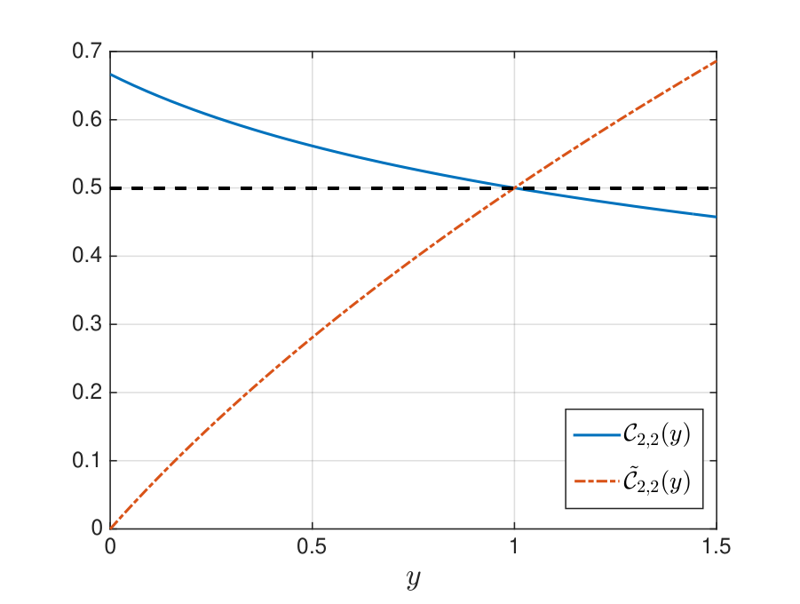</a>
<a href="/papers/2018_sspalmm/"><span class="pub-title">Strong-stability-preserving additive linear multistep methods</span></a><br>
<span class="pub-authors">Yiannis Hadjimichael  and David I. Ketcheson</span>,
<span class="pub-journal">Math. of Comp.</span>, 87(313):2295--2320 (2018)<br>
<span class="pub-links"><a href="/papers/2018_sspalmm/">More information</a> | <a href="https://doi.org/10.1090/mcom/3296">Published version</a> | <a href="https://arxiv.org/abs/1601.03637">arXiv version</a></span><div style="clear:both"></div>

</div>

<div class="pub filterable ssp time-integration runge-kutta">
<a href="/papers/2017_dense/">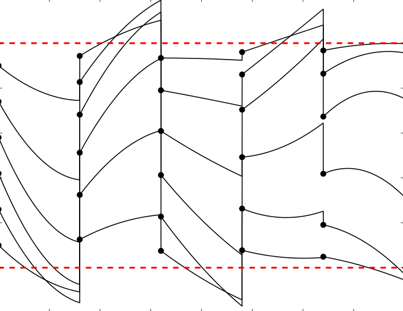</a>
<a href="/papers/2017_dense/"><span class="pub-title">Dense output for strong stability preserving Runge–Kutta methods</span></a><br>
<span class="pub-authors">David I. Ketcheson, Lajos Lóczi, Aliya Jangabylova,  and Adil Kusmanov</span>,
<span class="pub-journal">Journal of Scientific Computing</span>, 71(3):944--958 (2017)<br>
<span class="pub-links"><a href="/papers/2017_dense/">More information</a> | <a href="https://doi.org/10.1007/s10915-016-0331-5">Published version</a> | <a href="https://arxiv.org/abs/1605.02429">arXiv version</a></span><div style="clear:both"></div>

</div>

<div class="pub filterable time-integration ssp runge-kutta multistep">
<a href="/papers/2017_msrk/">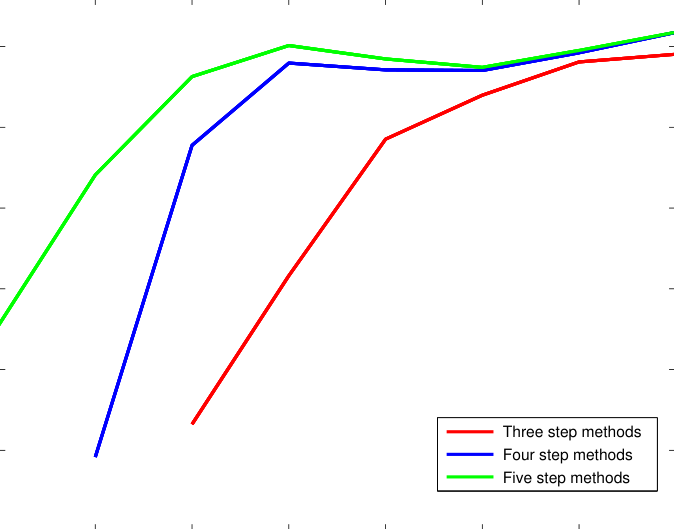</a>
<a href="/papers/2017_msrk/"><span class="pub-title">Explicit Strong Stability Preserving Multistep Runge-Kutta Methods</span></a><br>
<span class="pub-authors">Christopher Bresten, Sigal Gottlieb, Zachary Grant, Daniel Higgs, David I. Ketcheson,  and Adrian Németh</span>,
<span class="pub-journal">Math. of Comp.</span>, 86 (2017)<br>
<span class="pub-links"><a href="/papers/2017_msrk/">More information</a> | <a href="https://doi.org/10.1090/mcom/3115">Published version</a> | <a href="https://arxiv.org/abs/1307.8058">arXiv version</a></span><div style="clear:both"></div>

</div>

<div class="pub filterable time-integration">
<a href="/papers/2016_splitting_methods/"><span class="pub-title">Practical splitting methods for the adaptive integration of nonlinear evolution equations. Part I: Construction of optimized schemes and pairs of schemes</span></a><br>
<span class="pub-authors">Winfried Auzinger, Harald Hofstätter, David I. Ketcheson,  and Othmar Koch</span>,
<span class="pub-journal">BIT Numerical Mathematics</span>, 57(1):55--74 (2017)<br>
<span class="pub-links"><a href="/papers/2016_splitting_methods/">More information</a> | <a href="https://doi.org/10.1007/s10543-016-0626-9">Published version</a> | <a href="https://arxiv.org/abs/1604.01179">arXiv version</a></span><div style="clear:both"></div>

</div>

<div class="pub filterable hyperbolic software">
<a href="/papers/2016_clawpack/">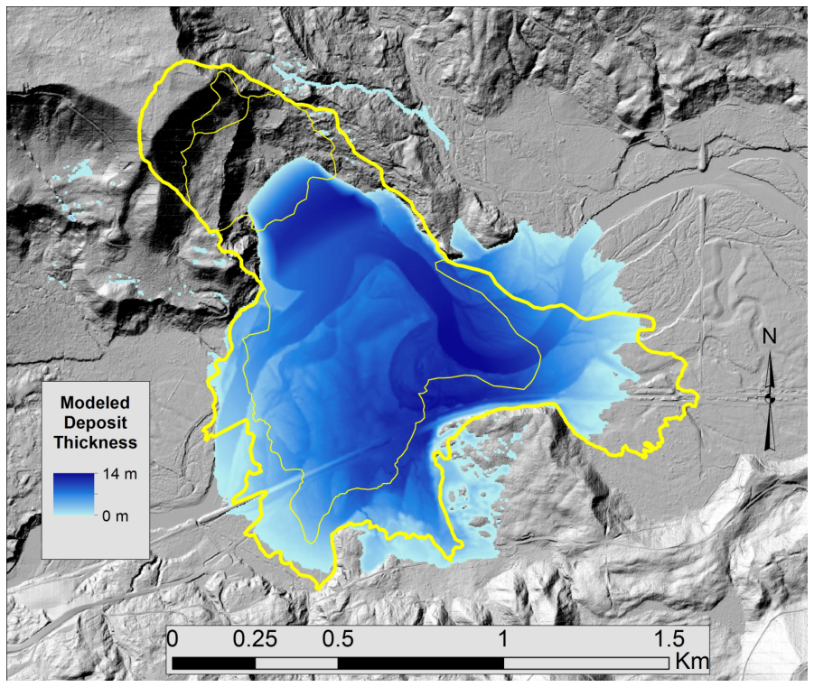</a>
<a href="/papers/2016_clawpack/"><span class="pub-title">Clawpack: building an open source ecosystem for solving hyperbolic PDEs</span></a><br>
<span class="pub-authors">Kyle T Mandli, Aron J Ahmadia, Marsha Berger, Donna Calhoun, David L George, Yiannis Hadjimichael, David I Ketcheson, Grady I Lemoine,  and Randall J LeVeque</span>,
<span class="pub-journal">PeerJ Computer Science</span>, 2 (2016)<br>
<span class="pub-links"><a href="/papers/2016_clawpack/">More information</a> | <a href="https://doi.org/10.7717/peerj-cs.68">Published version</a></span><div style="clear:both"></div>

</div>

<div class="pub filterable time-integration ssp multistep">
<a href="/papers/2016_ssp_lmm_vss/"></a>
<a href="/papers/2016_ssp_lmm_vss/"><span class="pub-title">Strong stability preserving explicit linear multistep methods with variable step size</span></a><br>
<span class="pub-authors">Yiannis Hadjimichael, David I. Ketcheson, Lajos Lóczi,  and Adrián Németh</span>,
<span class="pub-journal">SIAM Journal On Numerical Analysis</span>, 54(5):2799-2832 (2016)<br>
<span class="pub-links"><a href="/papers/2016_ssp_lmm_vss/">More information</a> | <a href="https://doi.org/10.1137/15M101717X">Published version</a> | <a href="https://arxiv.org/abs/1504.04107">arXiv version</a> | <a href="https://github.com/numerical-mathematics/ssp-lmm-vss_RR">Reproducibility repository</a></span><div style="clear:both"></div>

</div>

<div class="pub filterable periodic-media hyperbolic">
<a href="/papers/2015_diffractons/"></a>
<a href="/papers/2015_diffractons/"><span class="pub-title">Diffractons: Solitary Waves Created by Diffraction in Periodic Media</span></a><br>
<span class="pub-authors">David I. Ketcheson  and Manuel Quezada de Luna</span>,
<span class="pub-journal">Multiscale Modeling & Simulation</span>, 13(1):440--458 (2015)<br>
<span class="pub-links"><a href="/papers/2015_diffractons/">More information</a> | <a href="https://doi.org/10.1137/130946526">Published version</a> | <a href="https://arxiv.org/abs/1312.4122">arXiv version</a> | <a href="https://github.com/ketch/diffractons_RR">Reproducibility repository</a></span><div style="clear:both"></div>

</div>

<div class="pub filterable runge-kutta-time-integration-multi-rate runge-kutta time-integration">
<a href="/papers/2014_partitioned_multirate/"></a>
<a href="/papers/2014_partitioned_multirate/"><span class="pub-title">Error Analysis of Explicit Partitioned Runge-Kutta Schemes for Conservation Laws</span></a><br>
<span class="pub-authors">W. Hundsdorfer, D. I. Ketcheson,  and I. Savostianov</span>,
<span class="pub-journal">Journal of Scientific Computing</span>, 63(3):633--653 (2015)<br>
<span class="pub-links"><a href="/papers/2014_partitioned_multirate/">More information</a> | <a href="https://doi.org/10.1007/s10915-014-9906-1">Published version</a> | <a href="https://arxiv.org/abs/1310.7168">arXiv version</a> | <a href="/assets/papers/2014_partitioned_multirate_postprint.pdf">Free Postprint</a></span><div style="clear:both"></div>

</div>

<div class="pub filterable runge-kutta-time-integration runge-kutta time-integration">
<a href="/papers/2015_exponential_stability_regions/"></a>
<a href="/papers/2015_exponential_stability_regions/"><span class="pub-title">On the absolute stability regions corresponding to partial sums of the exponential function</span></a><br>
<span class="pub-authors">David I. Ketcheson, Tihamer A. Kocsis,  and Lajos Lóczi</span>,
<span class="pub-journal">IMA Journal of Numerical Analysis</span>, 35(3):1426-1455 (2015)<br>
<span class="pub-links"><a href="/papers/2015_exponential_stability_regions/">More information</a> | <a href="https://imajna.oxfordjournals.org/cgi/content/abstract/dru039?ijkey=k8rlLsKUMTuJVk4&keytype=ref">Paper</a> | <a href="https://doi.org/10.1093/imanum/dru039">Published version</a> | <a href="https://arxiv.org/abs/1312.0216">arXiv version</a></span><div style="clear:both"></div>

</div>

<div class="pub filterable extrapolation deferred-correction runge-kutta time-integration">
<a href="/papers/2014_hork/"></a>
<a href="/papers/2014_hork/"><span class="pub-title">A comparison of high order explicit Runge-Kutta, extrapolation, and deferred correction methods in serial and parallel</span></a><br>
<span class="pub-authors">David I. Ketcheson  and Umair bin Waheed</span>,
<span class="pub-journal">CAMCoS</span>, 9(2):175-200 (2014)<br>
<span class="pub-links"><a href="/papers/2014_hork/">More information</a> | <a href="/assets/papers/2014_hork.pdf">Free PDF</a> | <a href="https://doi.org/10.2140/camcos.2014.9.175">Published version</a> | <a href="https://arxiv.org/abs/1305.6165">arXiv version</a> | <a href="https://github.com/ketch/high_order_RK_RR/">Reproducibility repository</a></span><div style="clear:both"></div>

</div>

<div class="pub filterable internal-stability runge-kutta extrapolation ssp time-integration">
<a href="/papers/2014_internal_stability/"></a>
<a href="/papers/2014_internal_stability/"><span class="pub-title">Internal error propagation in explicit Runge–Kutta methods</span></a><br>
<span class="pub-authors">David I. Ketcheson, Lajos Lóczi,  and Matteo Parsani</span>,
<span class="pub-journal">SIAM Journal on Numerical Analysis</span>, 52(5):2227--2249 (2014)<br>
<span class="pub-links"><a href="/papers/2014_internal_stability/">More information</a> | <a href="/assets/papers/2014_internal_stability.pdf">Free PDF</a> | <a href="https://doi.org/10.1137/130936245">Published version</a> | <a href="https://arxiv.org/abs/1309.1317">arXiv version</a></span><div style="clear:both"></div>

</div>

<div class="pub filterable heterogeneous-media nonlinear-waves p-system periodic-media solitary-waves soliton-interaction hyperbolic">
<a href="/papers/2014_cylindrical_solitary_waves/"></a>
<a href="/papers/2014_cylindrical_solitary_waves/"><span class="pub-title">Numerical simulation of cylindrical solitary waves in periodic media</span></a><br>
<span class="pub-authors">Manuel Quezada de Luna  and David I. Ketcheson</span>,
<span class="pub-journal">Journal of Scientific Computing</span>, 58(3):672-689 (2014)<br>
<span class="pub-links"><a href="/papers/2014_cylindrical_solitary_waves/">More information</a> | <a href="https://doi.org/10.1007/s10915-013-9747-3">Published version</a> | <a href="https://arxiv.org/abs/1209.5164">arXiv version</a> | <a href="/assets/papers/2014_cylindrical_solitary_waves_postprint.pdf">Free Postprint</a></span><div style="clear:both"></div>

</div>

<div class="pub filterable strong-stability-preserving ssp runge-kutta discontinuous-galerkin time-integration">
<a href="/papers/2014_ssp_rkdg/"></a>
<a href="/papers/2014_ssp_rkdg/"><span class="pub-title">Optimal strong-stability-preserving Runge–Kutta time discretizations for discontinuous Galerkin methods</span></a><br>
<span class="pub-authors">Ethan J. Kubatko, Benjamin A. Yeager,  and David I. Ketcheson</span>,
<span class="pub-journal">Journal of Scientific Computing</span>, 60(2):313-344 (2014)<br>
<span class="pub-links"><a href="/papers/2014_ssp_rkdg/">More information</a> | <a href="https://doi.org/10.1007/s10915-013-9796-7">Published version</a> | <a href="/assets/papers/dg_ssp_stability.pdf">Post-print</a></span><div style="clear:both"></div>

</div>

<div class="pub filterable absolute-monotonicity rational-function ssp">
<a href="/papers/2014_rational_absmon/"></a>
<a href="/papers/2014_rational_absmon/"><span class="pub-title">Rational functions with maximal radius of absolute monotonicity</span></a><br>
<span class="pub-authors">Lajos Lóczi  and David I. Ketcheson</span>,
<span class="pub-journal">LMS Journal of Computation and Mathematics</span>, 17(1):159--205 (2014)<br>
<span class="pub-links"><a href="/papers/2014_rational_absmon/">More information</a> | <a href="https://doi.org/10.1112/S1461157013000326">Published version</a> | <a href="https://arxiv.org/abs/1303.6651">arXiv version</a></span><div style="clear:both"></div>

</div>

<div class="pub filterable periodic-media hyperbolic">
<a href="/papers/quezada_dispersion/"></a>
<a href="/papers/quezada_dispersion/"><span class="pub-title">Two-dimensional wave propagation in layered periodic media</span></a><br>
<span class="pub-authors">Manuel Quezada de Luna  and David I. Ketcheson</span>,
<span class="pub-journal">SIAM Journal on Applied Mathematics</span>, 74(6):1852-1869 (2014)<br>
<span class="pub-links"><a href="/papers/quezada_dispersion/">More information</a> | <a href="https://doi.org/10.1137/130937962">Published version</a> | <a href="https://arxiv.org/abs/1309.6666">arXiv version</a> | <a href="https://github.com/ketch/effective_dispersion_RR">Reproducibility repository</a></span><div style="clear:both"></div>

</div>

<div class="pub filterable runge-kutta method-of-lines optimization spectral-difference time-integration">
<a href="/papers/2013_sd_erk/"></a>
<a href="/papers/2013_sd_erk/"><span class="pub-title">Optimized explicit Runge-Kutta schemes for the spectral difference method applied to wave propagation problems</span></a><br>
<span class="pub-authors">Matteo Parsani, David I. Ketcheson,  and Willem Deconinck</span>,
<span class="pub-journal">SIAM Journal on Scientific Computing</span>, 35(2):A957-A986 (2013)<br>
<span class="pub-links"><a href="/papers/2013_sd_erk/">More information</a> | <a href="/assets/papers/2013_sd_erk.pdf">Free PDF</a> | <a href="https://doi.org/10.1137/120885899">Published version</a> | <a href="https://arxiv.org/abs/1207.5830">arXiv version</a> | <a href="https://github.com/ketch/optimized-erk-sd-rr">Reproducibility repository</a></span><div style="clear:both"></div>

</div>

<div class="pub filterable runge-kutta weno clawpack finite-volumes high-order-methods hyperbolic-pdes hyperbolic numerical-methods scientific-computing scientific-software sharpclaw">
<a href="/papers/2013_sharpclaw/"></a>
<a href="/papers/2013_sharpclaw/"><span class="pub-title">High-order Wave Propagation Algorithms for Hyperbolic Systems</span></a><br>
<span class="pub-authors">David I. Ketcheson, Matteo Parsani,  and Randall J. LeVeque</span>,
<span class="pub-journal">SIAM Journal on Scientific Computing</span>, 35(1):A351--A377 (2013)<br>
<span class="pub-links"><a href="/papers/2013_sharpclaw/">More information</a> | <a href="/assets/papers/sharpclaw.pdf">Free PDF</a> | <a href="https://doi.org/10.1137/110830320">Published version</a> | <a href="https://arxiv.org/abs/1111.3499">arXiv version</a></span><div style="clear:both"></div>

</div>

<div class="pub filterable runge-kutta-methods runge-kutta convergence positivity time-integration">
<a href="/papers/2013_sperk/"></a>
<a href="/papers/2013_sperk/"><span class="pub-title">Spatially partitioned embedded Runge–Kutta methods</span></a><br>
<span class="pub-authors">David I. Ketcheson, Colin B. Macdonald,  and Steven J. Ruuth</span>,
<span class="pub-journal">SIAM Journal On Numerical Analysis</span>, 51(5):2887-2910 (2013)<br>
<span class="pub-links"><a href="/papers/2013_sperk/">More information</a> | <a href="/assets/papers/2013_sperk.pdf">Free PDF</a> | <a href="https://doi.org/10.1137/130906258">Published version</a> | <a href="https://arxiv.org/abs/1301.4006">arXiv version</a></span><div style="clear:both"></div>

</div>

<div class="pub filterable effective-order strong-stability-preservation ssp runge-kutta time-integration">
<a href="/papers/2013_effective_order_ssp/"></a>
<a href="/papers/2013_effective_order_ssp/"><span class="pub-title">Strong Stability Preserving Explicit Runge–Kutta Methods of Maximal Effective Order</span></a><br>
<span class="pub-authors">Yiannis Hadjimichael, Colin B. Macdonald, David I. Ketcheson,  and J. H. Verner</span>,
<span class="pub-journal">SIAM Journal on Numerical Analysis</span>, 51(4):2149--2165 (2013)<br>
<span class="pub-links"><a href="/papers/2013_effective_order_ssp/">More information</a> | <a href="/assets/papers/2013_effective_order_ssp.pdf">Free PDF</a> | <a href="https://doi.org/10.1137/120884201">Published version</a> | <a href="https://arxiv.org/abs/1207.2902">arXiv version</a></span><div style="clear:both"></div>

</div>

<div class="pub filterable clawpack finite-volumes hyperbolic-pdes hyperbolic petclaw pyclaw python sharpclaw">
<a href="/papers/2012_pyclaw-sisc/"></a>
<a href="/papers/2012_pyclaw-sisc/"><span class="pub-title">PyClaw: Accessible, Extensible, Scalable Tools for Wave Propagation Problems</span></a><br>
<span class="pub-authors">David I. Ketcheson, Kyle T. Mandli, Aron J. Ahmadia, Amal Alghamdi, Manuel Quezada de Luna, Matteo Parsani, Matthew G. Knepley,  and Matthew Emmett</span>,
<span class="pub-journal">SIAM Journal on Scientific Computing</span>, 34(4):C210--C231 (2012)<br>
<span class="pub-links"><a href="/papers/2012_pyclaw-sisc/">More information</a> | <a href="/assets/papers/2012_pyclaw-sisc.pdf">Free PDF</a> | <a href="https://doi.org/10.1137/110856976">Published version</a> | <a href="https://arxiv.org/abs/1111.6583">arXiv version</a> | <a href="https://numerics.kaust.edu.sa/papers/pyclaw-sisc/pyclaw-sisc.html">Figures with interactive code</a> | <a href="https://doi.org/10.5281/zenodo.24432819">Reproducibility repository</a></span><div style="clear:both"></div>

</div>

<div class="pub filterable numerical-analysis optimization-and-control time-integration runge-kutta">
<a href="/papers/2012_optimal_stability_polynomials/"></a>
<a href="/papers/2012_optimal_stability_polynomials/"><span class="pub-title">Optimal stability polynomials for numerical integration of initial value problems</span></a><br>
<span class="pub-authors">David I. Ketcheson  and Aron J. Ahmadia</span>,
<span class="pub-journal">Communications in Applied Mathematics and Computational Science</span>, 7(2):247--271 (2012)<br>
<span class="pub-links"><a href="/papers/2012_optimal_stability_polynomials/">More information</a> | <a href="/assets/papers/2012_optimal_stability_polynomials.pdf">Free PDF</a> | <a href="https://doi.org/10.2140/camcos.2012.7.247">Published version</a> | <a href="https://arxiv.org/abs/1201.3035">arXiv version</a> | <a href="https://github.com/ketch/RK-opt">code</a></span><div style="clear:both"></div>

</div>

<div class="pub filterable clawpack computational-science elasticity hyperbolic-pdes hyperbolic laminates layered-media nonlinear-waves periodic-media sharpclaw shock-waves solitary-waves spatially-varying-flux">
<a href="/papers/2012_ketchesonleveque_periodic/"></a>
<a href="/papers/2012_ketchesonleveque_periodic/"><span class="pub-title">Shock Dynamics in Layered Periodic Media</span></a><br>
<span class="pub-authors">David I. Ketcheson  and Randall J. LeVeque</span>,
<span class="pub-journal">Communications in Mathematical Sciences</span>, 10(3):859--874 (2012)<br>
<span class="pub-links"><a href="/papers/2012_ketchesonleveque_periodic/">More information</a> | <a href="/assets/papers/2012_ketchesonleveque_periodic.pdf">Free PDF</a> | <a href="https://doi.org/10.4310/CMS.2012.v10.n3.a7">Published version</a> | <a href="https://arxiv.org/abs/1105.2892">arXiv version</a> | <a href="https://github.com/ketch/layeredmediashocks">Reproducibility repository</a></span><div style="clear:both"></div>

</div>

<div class="pub filterable ssp runge-kutta time-integration">
<a href="/papers/2011_tsrk/"></a>
<a href="/papers/2011_tsrk/"><span class="pub-title">Strong Stability Preserving Two-step Runge–Kutta Methods</span></a><br>
<span class="pub-authors">David I. Ketcheson, Sigal Gottlieb,  and Colin B. Macdonald</span>,
<span class="pub-journal">SIAM Journal on Numerical Analysis</span>, 49(6):2618-2639 (2011)<br>
<span class="pub-links"><a href="/papers/2011_tsrk/">More information</a> | <a href="/assets/papers/2011_tsrk.pdf">Free PDF</a> | <a href="https://doi.org/10.1137/10080960X">Published version</a> | <a href="https://arxiv.org/abs/1106.3626">arXiv version</a></span><div style="clear:both"></div>

</div>

<div class="pub filterable numerical-analysis runge-kutta ssp downwind hyperbolic-pdes hyperbolic implicit linear-multistep-methods strong-stability-preservation time-integration">
<a href="/papers/2011_dwssp/"></a>
<a href="/papers/2011_dwssp/"><span class="pub-title">Step Sizes for Strong Stability Preservation with Downwind-Biased Operators</span></a><br>
<span class="pub-authors">David I. Ketcheson</span>,
<span class="pub-journal">SIAM Journal on Numerical Analysis</span>, 49(4):1649 (2011)<br>
<span class="pub-links"><a href="/papers/2011_dwssp/">More information</a> | <a href="https://numerics.kaust.edu.sa/papers/dwrk2011/downwind_ssp.html">Paper</a> | <a href="https://doi.org/10.1137/100818674">Published version</a> | <a href="https://arxiv.org/abs/1105.5798">arXiv version</a> | <a href="https://github.com/ketch/downwind_IRK_RR">Reproducibility repository</a></span><div style="clear:both"></div>

</div>

<div class="pub filterable ode-solver runge-kutta shu-osher-form algorithms low-storage numerical-methods optimization time-integration">
<a href="/papers/2010_LSRK/"><span class="pub-title">Runge–Kutta methods with minimum storage implementations</span></a><br>
<span class="pub-authors">David I. Ketcheson</span>,
<span class="pub-journal">Journal of Computational Physics</span>, 229(5):1763--1773 (2010)<br>
<span class="pub-links"><a href="/papers/2010_LSRK/">More information</a> | <a href="https://linkinghub.elsevier.com/retrieve/pii/S0021999109006251">Paper</a> | <a href="https://doi.org/10.1016/j.jcp.2009.11.006">Published version</a> | <a href="/assets/papers/2010_LSRK_postprint.pdf">Post-print</a></span><div style="clear:both"></div>

</div>

<div class="pub filterable ode-solver ssp optimization strong-stability-preservation time-integration">
<a href="/papers/2009_monotonicity-glms/"><span class="pub-title">Computation of optimal monotonicity preserving general linear methods</span></a><br>
<span class="pub-authors">David I. Ketcheson</span>,
<span class="pub-journal">Mathematics of Computation</span>, 78(267):1497--1513 (2009)<br>
<span class="pub-links"><a href="/papers/2009_monotonicity-glms/">More information</a> | <a href="/assets/papers/2009_monotonicity-glms.pdf">Free PDF</a> | <a href="https://doi.org/10.1090/S0025-5718-09-02209-1">Published version</a></span><div style="clear:both"></div>

</div>

<div class="pub filterable runge-kutta ssp implicit optimization strong-stability-preservation time-integration">
<a href="/papers/2009_implicit_ssp/"></a>
<a href="/papers/2009_implicit_ssp/"><span class="pub-title">Optimal implicit strong stability preserving Runge–Kutta methods</span></a><br>
<span class="pub-authors">David I. Ketcheson, Colin B. Macdonald,  and Sigal Gottlieb</span>,
<span class="pub-journal">Applied Numerical Mathematics</span>, 59(2):373--392 (2009)<br>
<span class="pub-links"><a href="/papers/2009_implicit_ssp/">More information</a> | <a href="https://linkinghub.elsevier.com/retrieve/pii/S0168927408000688">Paper</a> | <a href="https://doi.org/10.1016/j.apnum.2008.03.034">Published version</a> | <a href="/assets/papers/implicit_ssp_postprint.pdf">Post-print</a></span><div style="clear:both"></div>

</div>

<div class="pub filterable euler's-method ode-solver runge-kutta ssp contractivity general-linear-methods linear-multistep-methods method-of-lines monotonicity multistep-methods nonlinear-stability numerical-analysis numerical-methods optimization positivity review runge-kutta-methods spectral-deferred-correction-methods spectral-deferred-corrections strong-stability-preservation strong-stability-preserving time-discretization total-variation-diminishing time-integration">
<a href="/papers/2009_ssp_review/"></a>
<a href="/papers/2009_ssp_review/"><span class="pub-title">High Order Strong Stability Preserving Time Discretizations</span></a><br>
<span class="pub-authors">Sigal Gottlieb, David I. Ketcheson,  and Chi-Wang Shu</span>,
<span class="pub-journal">Journal of Scientific Computing</span>, 38(3):251--289 (2009)<br>
<span class="pub-links"><a href="/papers/2009_ssp_review/">More information</a> | <a href="http://www.springerlink.com/index/10.1007/s10915-008-9239-z">Paper</a> | <a href="https://doi.org/10.1007/s10915-008-9239-z">Published version</a> | <a href="/assets/papers/sspreview.pdf">Post-print</a></span><div style="clear:both"></div>

</div>

<div class="pub filterable ode-solver runge-kutta ssp low-storage optimization strong-stability-preservation time-integration">
<a href="/papers/2008_explicit_ssp/"></a>
<a href="/papers/2008_explicit_ssp/"><span class="pub-title">Highly Efficient Strong Stability Preserving Runge-Kutta Methods with Low-Storage Implementations</span></a><br>
<span class="pub-authors">David I. Ketcheson</span>,
<span class="pub-journal">SIAM Journal on Scientific Computing</span>, 30(4):2113--2136 (2008)<br>
<span class="pub-links"><a href="/papers/2008_explicit_ssp/">More information</a> | <a href="/assets/papers/2008_explicit_ssp.pdf">Free PDF</a> | <a href="https://doi.org/10.1137/07070485X">Published version</a></span><div style="clear:both"></div>

</div>

<div class="pub filterable radiation-transport">
<a href="/papers/Favorite2008/"><span class="pub-title">Surface and Volume Integrals of Uncollided Adjoint Fluxes and Forward-Adjoint Flux Products</span></a><br>
<span class="pub-authors">Jeffrey A. Favorite, Keith C. Bledsoe,  and David I. Ketcheson</span>,
<span class="pub-journal">Nuclear Science and Engineering</span> (2008)<br>
<span class="pub-links"><a href="/papers/Favorite2008/">More information</a> | <a href="http://www.new.ans.org/pubs/journals/nse/a_9070">Paper</a> | <a href="https://doi.org/10.13182/nse163-73">Published version</a></span><div style="clear:both"></div>

</div>

<div class="pub filterable inverse-problem optimization radiation-transport">
<a href="/papers/2007_Favorite_marq/"><span class="pub-title">Using the Levenberg-Marquardt method for the solution of inverse transport problems</span></a><br>
<span class="pub-authors">Jeffrey A. Favorite  and David I. Ketcheson</span>,
<span class="pub-journal">Transactions of the American Nuclear Society</span>, 95 (2006)<br>
<span class="pub-links"><a href="/papers/2007_Favorite_marq/">More information</a> | <a href="/assets/papers/2007_Favorite_marq.pdf">Free PDF</a></span><div style="clear:both"></div>

</div>

<div class="pub filterable runge-kutta ssp optimization strong-stability-preservation time-integration">
<a href="/papers/2005_ketcheson_robinson/"></a>
<a href="/papers/2005_ketcheson_robinson/"><span class="pub-title">On the practical importance of the SSP property for Runge-Kutta time integrators for some common Godunov-type schemes</span></a><br>
<span class="pub-authors">David I. Ketcheson  and Allen C. Robinson</span>,
<span class="pub-journal">International Journal for Numerical Methods in Fluids</span>, 48(3):271--303 (2005)<br>
<span class="pub-links"><a href="/papers/2005_ketcheson_robinson/">More information</a> | <a href="https://doi.org/10.1002/fld.837">Published version</a></span><div style="clear:both"></div>

</div>

<h2>Books</h2>
<div class="pub filterable ode-solver runge-kutta ssp contractivity general-linear-methods initial-value-problems linear-multistep-methods low-storage monotonicity nonlinear-stability optimization positivity strong-stability-preservation total-variation-diminishing time-integration">
<a href="/papers/SSPbook/"><span class="pub-title">Strong Stability Preserving Runge-Kutta And Multistep Time Discretizations</span></a><br>
<span class="pub-authors">Sigal Gottlieb, David I. Ketcheson,  and Chi-Wang Shu</span>,
 (2011)<br>
<span class="pub-links"><a href="/papers/SSPbook/">More information</a> | <a href="https://www.amazon.com/Stability-Preserving-Runge-Kutta-Multistep-Discretizations/dp/9814289264">Book</a> | <a href="https://doi.org/10.1142/7498">Published version</a></span><div style="clear:both"></div>

</div>

<h2>Conference Proceedings</h2>
<div class="pub filterable hyperbolic">
<a href="/papers/rajvanshi2024integral/"><span class="pub-title">Integral PINNS for hyperbolic conservation laws</span></a><br>
<span class="pub-authors">Manvendra P Rajvanshi  and David I Ketcheson</span>,
in ICLR 2024 Workshop on AI4DifferentialEquations In Science. (2024)<br>
<span class="pub-links"><a href="/papers/rajvanshi2024integral/">More information</a> | <a href="https://openreview.net/pdf?id=Uuu6HWe6dF">Paper</a></span><div style="clear:both"></div>

</div>

<div class="pub filterable runge-kutta time-integration">
<a href="/papers/2018_wso/"></a>
<a href="/papers/2018_wso/"><span class="pub-title">DIRK Schemes with High Weak Stage Order</span></a><br>
<span class="pub-authors">David I. Ketcheson, Benjamin Seibold, David Shirokoff,  and Dong Zhou</span>,
in Spectral and High Order Methods for Partial Differential Equations ICOSAHOM 2018. (2018)<br>
<span class="pub-links"><a href="/papers/2018_wso/">More information</a> | <a href="https://doi.org/10.1007/978-3-030-39647-3_36">Published version</a> | <a href="https://arxiv.org/abs/1811.01285">arXiv version</a></span><div style="clear:both"></div>

</div>

<div class="pub filterable ">
<a href="/papers/2014scipy/"></a>
<a href="/papers/2014scipy/"><span class="pub-title">Teaching numerical methods with IPython notebooks and inquiry-based learning</span></a><br>
<span class="pub-authors">David I. Ketcheson</span>,
 Available from http://conference.scipy.org/proceedings/scipy2014/ketcheson.htmlin {P}roceedings of the 13th {P}ython in {S}cience {C}onference. (2014)<br>
<span class="pub-links"><a href="/papers/2014scipy/">More information</a> | <a href="https://doi.org/10.25080/majora-14bd3278-004">Published version</a></span><div style="clear:both"></div>

</div>

<div class="pub filterable high-order-spectral-difference-method optimized-explicit-runge-kutta runge-kutta wave-propagation hyperbolic time-integration">
<a href="/papers/Parsani_finnish/"></a>
<a href="/papers/Parsani_finnish/"><span class="pub-title">Optimized low-order explicit Runge-Kutta schemes for high- order spectral difference method</span></a><br>
<span class="pub-authors">Matteo Parsani  and David I Ketcheson</span>,
in Proceedings of the 11th Finnish Mechanics Days. (2012)<br>
<span class="pub-links"><a href="/papers/Parsani_finnish/">More information</a> | <a href="https://www.oulu.fi/mekapaivat2012/meka2012_proceedings.pdf">Paper</a></span><div style="clear:both"></div>

</div>

<div class="pub filterable runge-kutta time-integration">
<a href="/papers/parsani-eccomas/"></a>
<a href="/papers/parsani-eccomas/"><span class="pub-title">Explicit Runge-Kutta schemes for the spectral difference method applied to wave propagation problems</span></a><br>
<span class="pub-authors">Matteo Parsani, David I. Ketcheson,  and Willem Deconinck</span>,
in Proceedings of the European Congress on Computational Methods in Applied Sciences and Engineering. (2012)<br>
<span class="pub-links"><a href="/papers/parsani-eccomas/">More information</a></span><div style="clear:both"></div>

</div>

<div class="pub filterable runge-kutta time-integration">
<a href="/papers/Parsani2012/"><span class="pub-title">Design of optimal explicit linearly stable strong stability preserving Runge-Kutta schemes for the spectral difference method</span></a><br>
<span class="pub-authors">Matteo Parsani  and David I. Ketcheson</span>,
 Extended abstract.in International Conference on Spectral and High Order Methods. (2012)<br>
<span class="pub-links"><a href="/papers/Parsani2012/">More information</a></span><div style="clear:both"></div>

</div>

<div class="pub filterable bluegene/p shaheen clawpack computational-science finite-volumes high-performance-computing numpy parallel petclaw petsc petsc4py python scaling scientific-computing scientific-software weak-scaling hyperbolic">
<a href="/papers/alghamdipetclaw/"></a>
<a href="/papers/alghamdipetclaw/"><span class="pub-title">PetClaw: A Scalable Parallel Nonlinear Wave Propagation Solver for Python</span></a><br>
<span class="pub-authors">Amal Alghamdi, Aron J. Ahmadia, David I. Ketcheson, Matthew G. Knepley, Kyle T. Mandli,  and Lisandro Dalcin</span>,
in Proceedings of SpringSim '11. (2011)<br>
<span class="pub-links"><a href="/papers/alghamdipetclaw/">More information</a> | <a href="https://numerics.kaust.edu.sa/papers/petclaw2011/petclaw2011.html">Paper</a></span><div style="clear:both"></div>

</div>

<div class="pub filterable python hyperbolic">
<a href="/papers/scipy2011pyclaw/"></a>
<a href="/papers/scipy2011pyclaw/"><span class="pub-title">Using Python to Construct a Scalable Parallel Nonlinear Wave Solver</span></a><br>
<span class="pub-authors">Kyle T. Mandli, Amal Alghamdi, Aron J. Ahmadia, David I. Ketcheson,  and W. Scullin</span>,
in Proceedings of SciPy 2011. (2011)<br>
<span class="pub-links"><a href="/papers/scipy2011pyclaw/">More information</a> | <a href="http://conference.scipy.org/proceedings/scipy2011/pdfs/mandli_etal.pdf">Paper</a> | <a href="https://doi.org/10.25080/majora-ebaa42b7-00c">Published version</a></span><div style="clear:both"></div>

</div>

<div class="pub filterable weno finite-volumes hyperbolic-pdes hyperbolic">
<a href="/papers/wenoclaw/"></a>
<a href="/papers/wenoclaw/"><span class="pub-title">WENOCLAW: A higher order wave propagation method</span></a><br>
<span class="pub-authors">David I. Ketcheson  and Randall J. LeVeque</span>,
in Hyperbolic Problems: Theory, Numerics, Applications: Proceedings of the Eleventh International Conference on Hyperbolic Problems. (2008)<br>
<span class="pub-links"><a href="/papers/wenoclaw/">More information</a> | <a href="/assets/papers/hyp2006_wenoclaw.pdf">Free PDF</a> | <a href="https://doi.org/10.1007/978-3-540-75712-2_60">Published version</a></span><div style="clear:both"></div>

</div>

<div class="pub filterable ">
<a href="/papers/mcnamara2004luminosities/"><span class="pub-title">The luminosities of horizontal branches and RR Lyrae stars in globular clusters</span></a><br>
<span class="pub-authors">DH McNamara, MB Rose, PJ Brown, DI Ketcheson, JE Maxwell, KM Smith,  and RC Wooley</span>,
in IAU Colloq. 193: Variable Stars in the Local Group. (2004)<br>
<span class="pub-links"><a href="/papers/mcnamara2004luminosities/">More information</a> | <a href="https://doi.org/10.1017/s025292110001126x">Published version</a></span><div style="clear:both"></div>

</div>

<div class="pub filterable ">
<a href="/papers/ketcheson2002ccd/"><span class="pub-title">CCD Photometry of Variables in the Field of QS Geminorum</span></a><br>
<span class="pub-authors">David I. Ketcheson, PJ Brown,  and EG Hintz</span>,
in Bulletin of the American Astronomical Society. (2002)<br>
<span class="pub-links"><a href="/papers/ketcheson2002ccd/">More information</a></span><div style="clear:both"></div>

</div>

<h2>Technical Reports</h2>
<div class="pub filterable epidemiology">
<a href="/papers/ketcheson2020estimating/"><span class="pub-title">Estimating and forecasting COVID-19 attack rates and mortality</span></a><br>
<span class="pub-authors">David I Ketcheson, Hernando Ombao, Paula Moraga, Tarig Ballal,  and Carlos M Duarte</span>,
 (2020)<br>
<span class="pub-links"><a href="/papers/ketcheson2020estimating/">More information</a> | <a href="https://doi.org/10.1101/2020.05.11.20097972">medRxiv version</a></span><div style="clear:both"></div>

</div>

<div class="pub filterable time-integration">
<a href="/papers/2015_practical_splitting/"><span class="pub-title">Practical splitting methods for the adaptive integration of nonlinear evolution equations. Part I: Construction of optimized schemes and pairs of schemes</span></a><br>
<span class="pub-authors">W. Auzinger, H. Hofstatter, David I. Ketcheson,  and O. Koch</span>,
 (2015)<br>
<span class="pub-links"><a href="/papers/2015_practical_splitting/">More information</a> | <a href="/assets/papers/2015_practical_splitting.pdf">Free PDF</a></span><div style="clear:both"></div>

</div>

<div class="pub filterable internal-stability runge-kutta extrapolation ssp time-integration">
<a href="/papers/internal_stability_report/"></a>
<a href="/papers/internal_stability_report/"><span class="pub-title">Propagation of internal errors in explicit Runge–Kutta methods and internal stability of SSP and extrapolation methods</span></a><br>
<span class="pub-authors">David I Ketcheson, Lajos Lóczi,  and Matteo Parsani</span>,
 (2013)<br>
<span class="pub-links"><a href="/papers/internal_stability_report/">More information</a> | <a href="https://doi.org/10.48550/arXiv.1309.1317">Published version</a> | <a href="https://arxiv.org/abs/1309.1317">arXiv version</a></span><div style="clear:both"></div>

</div>

<div class="pub filterable eulerian kinematics lagrangian solid-mechanics hyperbolic">
<a href="/papers/2009_kinematics/"></a>
<a href="/papers/2009_kinematics/"><span class="pub-title">A Comparison of Lagrangian/Eulerian Approaches for Tracking the Kinematics of High Deformation Solid Motion</span></a><br>
<span class="pub-authors">Allen C. Robinson, David I. Ketcheson, T.L. Ames,  and G.V. Farnsworth</span>,
 (2009)<br>
<span class="pub-links"><a href="/papers/2009_kinematics/">More information</a> | <a href="/assets/papers/2009_kinematics.pdf">Free PDF</a> | <a href="https://doi.org/10.2172/984939">Published version</a></span><div style="clear:both"></div>

</div>

<div class="pub filterable ">
<a href="/papers/2005_ketcheson_lanl_scattering/"></a>
<a href="/papers/2005_ketcheson_lanl_scattering/"><span class="pub-title">Inverse Solution Methods and Perturbation Estimates for Radiation Leakage without Scattering</span></a><br>
<span class="pub-authors">David I. Ketcheson</span>,
 (2005)<br>
<span class="pub-links"><a href="/papers/2005_ketcheson_lanl_scattering/">More information</a> | <a href="/assets/papers/2005_ketcheson_lanl_scattering.pdf">Free PDF</a></span><div style="clear:both"></div>

</div>

<div class="pub filterable ssp central-schemes godunov-type-methods hyperbolic-pdes hyperbolic method-of-lines strong-stability-preservation time-discretization time-integration runge-kutta">
<a href="/papers/Christon2003/"><span class="pub-title">An assessment of semi-discrete central schemes for hyperbolic conservation laws</span></a><br>
<span class="pub-authors">Mark A Christon, David I. Ketcheson,  and Allen C. Robinson</span>,
 (2003)<br>
<span class="pub-links"><a href="/papers/Christon2003/">More information</a> | <a href="https://doi.org/10.2172/918357">Published version</a></span><div style="clear:both"></div>

</div>

<h2>Theses</h2>
<div class="pub filterable ode-solver runge-kutta ssp downwinding general-linear-methods homogenization linear-multistep-methods nonlinear-waves numerical-analysis numerical-methods optimization sharpclaw stability stegotons strong-stability-preservation total-variation-diminishing time-integration hyperbolic">
<a href="/papers/2009_phdthesis/"></a>
<a href="/papers/2009_phdthesis/"><span class="pub-title">High Order Strong Stability Preserving Time Integrators and Numerical Wave Propagation Methods for Hyperbolic PDEs</span></a><br>
<span class="pub-authors">David I. Ketcheson</span>,
 University of Washington, (2009)<br>
<span class="pub-links"><a href="/papers/2009_phdthesis/">More information</a> | <a href="/assets/papers/ketchesonphdthesis.pdf">Free PDF</a></span><div style="clear:both"></div>

</div>
</div>
```
